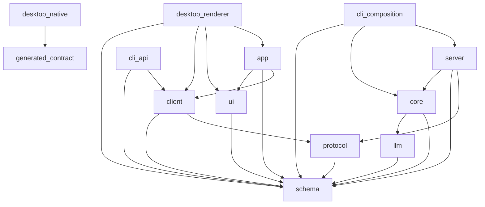
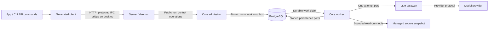

# Module Layout & Boundaries

Normative package map for the proposed Harness TypeScript/Bun modular monolith.
This is a documentation contract: the ten package directories currently contain
placeholders, not an implemented runtime. This file is the authoritative current
package ownership decision.

## Package responsibilities

Each package exposes declared public exports, not its entire source tree. The ten package responsibilities below define the proposed Harness boundaries.

### schema

**Harness:** Safe domain data contracts: IDs, CandidateFinding, SourceSnapshot references,
run projections, events and unverified verdict data. Public exports are codecs,
validators and inferred TypeScript types. A codec can have different encoded and
decoded forms. Merely importing it does not validate input; a boundary must decode it.
No Drizzle tables, migrations, DB driver, credentials, GroundTruthLabel, scoring metadata
or business decisions belong here. Shared types confer no access authority.

### protocol

**Harness:** Application API paths/operations, payloads, errors, event transport and
middleware contracts built on schema. Public surface is the canonical API definition.
This describes the client/server agreement; it is neither a server nor a second agent loop.
It owns no DB queries or provider wire format. Framework choice is distinct from this role.

### core

**Harness:** `run_control`, `source_access`,
agent_runtime, judge, evaluation and isolated scoring, with future audit/verification seams.
Own domain rules, use cases, ports, adapters, resource lifetime and capability persistence.
Public subpaths expose operations/types and narrowly scoped composition services.
Private stores/SQL are not cross-capability APIs. Tests and migration contributions live
with their capability; no empty layer directories are required just to match a template.

### llm

**Harness:** Public one-attempt model port, normalized requests/results/events, adapter
errors, profile checks, credentials, sanitization, usage/cost accounting and explicit retry
mechanisms under the existing run policy. Core owns continuation, tool execution,
committed history and Judge decisions. SDK types, credentials and native protocol objects
stay behind the port. The currently accepted official-SDK strategy remains in force; changing it requires a separate decision.

### Data, API, model and storage walkthrough

A representative flow makes the package boundaries concrete.

For Harness, safe RunInfo belongs to schema; a get-run request/response/error contract
belongs to protocol; its HTTP handler belongs to server; lookup/transaction and the
run table/migration belong to core/run_control. Project a stored row into RunInfo,
excluding leases, credentials and private control fields. Do not serialize an entire
DB row as the public response. A provider JSON encoder belongs to llm, not protocol.
The API protocol connects application clients to Harness; the provider protocol
connects the model adapter to the provider. Neither determines Judge domain policy.

### server

**Harness:** API routes,
authentication middleware, input decoding, safe error/response projections and public
server startup composition. Public surface is route/startup services. Business policy,
claims and run transitions remain in core; handlers do not duplicate them.

### client

**Harness:** Browser-safe generated API methods,
transport configuration and safe contract types. Runtime may import schema/protocol,
never server/core or generator tooling. Regenerate and review output when contracts
change; do not hand-maintain generated models. Node filesystem/codegen dependencies
belong to the generator only. Only endpoints included in the Harness API contract are exported.

### ui

**Harness:** React presentation components, styles and display helpers with public component props.
No business execution, DB/provider access or API orchestration. Safe schema values
may type display data; a button does not need a client dependency.

### app

**Harness:** React pages, navigation, forms, run/trace views and client-based state sync.
Public surface is app composition and presentation contracts. Keep browser dependencies limited to safe shared contracts and public clients.
UI cache and connection state never become authoritative run state.

### desktop

**Harness:** Tauri 2 native shell and the app renderer, window integration, scoped picker and protected transport.
Public surface is a narrow typed native bridge and generated runtime contract.
The native host owns installation credential custody, not model provider credentials.
No renderer/native DB access, tool execution, Judge/evaluation/scoring composition or
runtime lifetime authority. Supervision uses the existing independent-runtime contract.

### cli

**Harness:** Terminal product interface with two distinct entrypoints: ordinary run/status/evaluation
request commands use client; serve/start commands may assemble public server/core
startup services. Public surface is commands/options/output and startup wiring.
Do not duplicate an agent loop or bypass durable admission, claims, budgets and terminal
transitions. Ordinary CLI/serve cannot acquire scorer code or credentials. Evaluation
execution and scorer execution retain their separate process roots.

### Harness stack choices

The package definitions describe responsibilities and boundaries. They do not change
the project stack: React remains the presentation framework, Tauri 2 the desktop shell,
and PostgreSQL with Drizzle the datastore. The provider integration strategy remains
direct official-SDK adapters behind the project-owned `llm` port; SDK types and hidden
provider behavior do not cross that boundary. Bun and Turborepo manage the TypeScript
monorepo. Any stack migration requires a separate explicit decision.

### OpenCode reuse decision

OpenCode is an inspected source reference and selective source reuse is authorized in
principle. This does not make it a dependency or fork, and does not mean any code has
already been copied or reviewed. Before each port, record the exact source revision and
adaptation, review applicable license notices, dependencies and security, and verify
the result against Harness contracts. Do not import upstream frameworks or product
behavior by default. In particular, upstream retries, continuation, hosted tools,
provider-owned conversation state or broader tool authority cannot bypass Harness
attempt accounting, budgets, committed history, read-only tools or scorer isolation.

## Dependency matrix

This is the Harness public-import **allowlist**.
An allowed dependency is not mandatory. Restrictions on subpaths and process closures
apply even when the package-level edge is allowed. External framework dependencies
are omitted. Type-only imports do not grant permission to expose private backend types.

| Consumer | Runtime internal dependencies | Type-only internal dependencies | Generation/build-only |
|---|---|---|---|
| schema | none | none | own schema tooling |
| protocol | schema | schema | API export tooling |
| llm | schema | schema | provider tooling |
| core | schema, llm | schema, llm | capability migration assembly |
| server | protocol, schema, core | protocol, schema, public core contracts | API generation |
| client | protocol, schema | protocol, schema | contract/codegen tooling; public server definitions only if needed |
| ui | schema | schema, protocol, public client contracts | browser bundler |
| app | client, schema, ui | schema, protocol, public client and UI contracts | browser bundler |
| desktop renderer | app, ui, client, schema | safe presentation exports; schema, protocol, public client contracts | browser bundler |
| desktop native host | generated transport contract only | generated transport contract only | native contract generation and packaging |
| cli API commands | client, schema | client, schema, protocol | CLI packaging |
| cli composition commands | public server/core startup, schema | same public startup contracts, schema | runtime packaging |

Generation may read backend definitions in a dedicated build process; emitted browser
artifacts must not import server/core/llm, generators, Node/Bun built-ins or scorer types.
Validate the resulting bundle/import closure, not merely the generator's manifest.
No type-only backdoor to private DB/scorer models is allowed. Same-package presentation
composition is allowed; all backend access remains through client transport.

### Runtime import graph

Arrows mean **consumer imports dependency**, matching the runtime column above.
Desktop native uses a generated contract, not a backend package import.

### Transport and execution flow

This diagram shows calls/data delivery, **not package imports**. Worker and daemon
are process roots; both compose public capabilities from the coordinated runtime.

## Capability placement and process isolation

The following paths are proposed placement, not existing implementation. Use public
package/subpath exports, e.g. `@harness/core/run-control`, not private SQL imports.
A literal `public/` directory is unnecessary. Capability code owns its domain,
application, ports, adapters, tests and migration contributions as they become needed.

| Owner | Proposed source and public seam | Persistence responsibility |
|---|---|---|
| run_control | `packages/core/src/run-control`; admission/status/events/claims | run/config/candidate, durable work/outbox/claims, safe trajectory and security event storage |
| source_access | `packages/core/src/source-access`; registration/snapshot/read ports | source registration, immutable inventory and managed content metadata |
| agent_runtime | `packages/core/src/agent-runtime`; turn/context/budget ports | steps, context allocation, tool-call projections |
| judge | `packages/core/src/judge`; candidate workflow and verdict ports | verdict/evidence |
| evaluation | `packages/core/src/evaluation`; frozen experiment and safe execution ports | experiment manifests and safe execution records; no labels |
| scoring | `packages/core/src/scoring`; scorer-entrypoint-only contracts | labels, adjudication and scoring metadata in restricted schema/role |
| model_gateway | `packages/llm/src`; one-attempt model port | port owns attempt/profile semantics; its PostgreSQL adapter and migration contribution live in `packages/core/src/model-gateway-persistence` |
| future audit | `packages/core/src/audit`; declared mode workflow seam | future findings/reports |
| future verification | separate VerificationRunner port/process seam | separate change; no PoC authority in Judge |

The gateway persistence adapter in core implements the llm-owned port; llm never imports
core. It is the gateway capability's persistence contribution, not permission for other
capabilities to query provider_attempt tables. All actual Drizzle tables/migrations are
backend-owned in core. Core infrastructure assembles drivers and selected migration
contributions; a global DB helper must not become a cross-capability query repository.
Foreign keys do not grant query permission. Use owning public operations and explicit
transaction ports for atomic changes described in the system overview.

### Composition and repository placement

- Daemon: `packages/server` public startup; optional `packages/cli` serve wiring.
- Worker: `packages/core` worker entrypoint composes admission/claims, source, agent and Judge plus llm adapters.
- Evaluator: separate `packages/core` evaluation entrypoint submits matched runs and consumes safe results; no scorer import or label credential.
- Scorer: separate `packages/core` scoring entrypoint consumes immutable outputs and restricted labels with its own DB role. It is not a service loaded by the ordinary CLI.
- Tests/migration contributions: colocate with capability owners; assembly selects only the role's contributions. A privileged offline migration process must not pass its credentials to daemon/worker.
- Configuration: versioned profile/config definitions at owning capabilities; resolved immutable values enter run snapshots. Provider secrets remain outside snapshots and generated contracts.
- Datasets: versioned manifests and managed safe inputs for evaluator/agent; label material accessible only to scorer outside source workspaces. Dataset packaging cannot silently bundle labels with source.
- Packaging: one coordinated runtime version, Bun dependency lock and compatibility contract for daemon/worker/evaluator/scorer. Desktop consumes generated transport contracts and performs the existing compatibility handshake.

Root `package.json` would declare Bun workspaces; `bunfig.toml` holds Bun settings;
`turbo.json` would orchestrate/cache tasks; `tsconfig.json` would share compiler settings.
These files are future implementation, not artifacts created by this change. Do not
infer a cloud deployment from an `infra` placeholder or introduce separate service
release ownership. Additional SDKs are projections, not alternate business runtimes.

### Boundary review walkthrough

1. Accept CandidateFinding and a safe immutable SourceSnapshot through schema/protocol.
   Server decodes and calls run_control; source_access grants bounded reads of managed content.
   Agent receives only those inputs and exact sanitized model-visible history.
2. Core projects run/verdict data through safe schema responses. GroundTruthLabel,
   adjudication reports, scoring metadata and credential resolution stay inside scoring.
3. Reject adding GroundTruthLabel to schema even if it is only a type: a shared/generated
   export crosses the data boundary. Reject a root core barrel exporting scoring even
   when CLI only asks for startup: transitive module initialization/re-exports may expose it.
4. Daemon, worker, evaluator, ordinary CLI/serve and renderer dependency closures exclude
   scoring modules, label schemas and scorer credentials. Scorer has a dedicated entrypoint,
   restricted DB schema/role and explicit safe output projection; package placement alone
   cannot enforce this. A migration registry must likewise select role-specific contributions.
5. Judge tools remain read-only and verdicts remain `unverified`. Authorize every tool
   before I/O; registry visibility does not replace checks in leaf executors. Exclude
   write/shell/PoC execution at both registry and executor boundaries.

Continuation, compaction, hosted tools and implicit retries require explicit review
before adoption. Keep per-call preflight/budgets, explicit observable attempts, exact
sanitized trace, immutable configuration, terminal CAS and recovery rules
from [system overview](system-overview.md) and [sequences](sequences.md). Optional
result-affecting changes need a separate change with flag, telemetry, immutable snapshot
value and enabled/disabled tests; mandatory isolation is never disableable.
