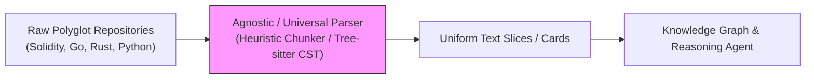

# Proposal: Compiler-Grade Slither AST Parsing vs. "Good-Enough" Universal Parsers in Smart Contract Static Analysis

## 1. Executive Summary

Automated smart contract analysis tools and LLM code-reasoning engines face an architectural dilemma: adopt a universal, language-agnostic code parser with "good-enough" performance, or engineer dedicated compiler-grade AST pipelines per target language. This proposal explores this dichotomy using empirical data from Hound's deployment on the **Nado Core protocol** (`nado-contracts/core`). We demonstrate that while language-agnostic parsers suffice for general text-based retrieval, they break down catastrophically in adversarial security domains. For Solidity, integrating a compiler-grade AST parser via [`SlitherCardParser`](file:///C:/Code/Solidity/tool/hound/ingest/slither_card_parser.py#L19-L50) restores syntactic integrity, eliminates ungrounded hallucinations, and dramatically boosts bug verification yield.

---

## 2. The Paper Idea: A Universal "Good-Enough" Language Parser

### 2.1 The Agnostic Vision

A prevalent paradigm in static code analysis and LLM-assisted software engineering is the universal parser (e.g., Tree-sitter, universal CSTs, ctags, or heuristic blank-line/line-chunk slicing). The core philosophy rests on three pillars:

- **Universal Polyglot Coverage:** A single unified ingestion engine handles Python, TypeScript, Go, Rust, and Solidity without maintaining separate toolchain runners or language compilers.
- **Zero Compilation Overhead:** Avoiding compilation bypasses missing dependency imports, mismatched compiler versions (`solc` 0.7 vs 0.8), external framework configs (`foundry.toml`, `hardhat.config.js`), and broken environment setups.
- **"Good-Enough" Performance Hypothesis:** Downstream Large Language Models (LLMs) are hypothesized to have sufficient semantic interpolation to bridge minor syntactic cuts, heuristic boundaries, and missing symbol tables.



Under this model, the ingestion layer treats code primarily as structured text, balancing shallow grammar parsing with high throughput and cross-ecosystem reach.

---

## 3. Empirical Observation: The Breakdown in `nado`

When the universal "good-enough" parsing paradigm was evaluated against real-world smart contracts in the Nado Core codebase, the hypothesis collapsed under domain-specific EVM execution realities.

### 3.1 Catastrophic Syntactic Severing

Agnostic chunkers split source code along arbitrary line counts, token thresholds, or top-level brace approximations. In the baseline run on Nado:

- **17.6% (178 / 1,006 functions)** in the baseline and **56.4% (114 / 202 cards)** in the naive fallback suffered from severed syntax (mismatched `{` vs `}`).
- Mid-function statements were sliced in half, truncating state variable mutations, event emissions, and return assignments.

### 3.2 Context Bloat & Entity Clustering

Without compiler-informed boundary detection, the universal parser could not differentiate between contract declarations, state layouts, modifiers, and executable routines:

- A single contract node (`Clearinghouse`) accumulated **up to 94 disjoint card chunks** (mean 40.0 cards per grounded node).
- Downstream LLM context windows were flooded with noisy, duplicated lexical fragments, drowning out core logic.

### 3.3 Graph Blindness and Hallucinations (`FP-HAL`)

- **59.0% of graph nodes were ungrounded:** 98 out of 166 nodes contained zero references to underlying code cards.
- Downstream agents were forced to infer or hallucinate contract interactions rather than reasoning over verified code artifacts.

### 3.4 Sliced Modifiers & Guardrail False Positives

Solidity relies heavily on modifier wrapping (e.g., `onlyEndpoint`, `onlyOwner`, `nonReentrant`). Because the universal parser severed modifiers from their associated function implementations:

- Downstream verification engines falsely deduced that critical entry points lacked caller authentication.
- **40 out of 148 initial hypotheses (27.0%)** were false positives caused solely by severed guardrails .

---

## 4. Solidity Focus: The Slither AST Parser Architecture

To resolve the structural failures of the universal parser, we suggest using compiler-grade AST ingestion engine: [`SlitherCardParser`](file:///C:/Code/Solidity/tool/hound/ingest/slither_card_parser.py#L19-L50).

### 4.1 Compiler AST vs. Shallow Text

Solidity exhibits unique semantic properties that necessitate compiler-assisted analysis:

1. **Inheritance Linearization (C3):** Function overrides and super calls require symbol resolution across inherited hierarchies.
2. **Access Control as Syntax Modifiers:** Modifiers are executed as function wrappers and must be explicitly bound to the function's AST card.
3. **Dataflow & State Mutation Tracking:** SlithIR calculates deterministic read/write sets on contract storage slots.
4. **Byte-to-Character Offset Mapping:** The Solidity compiler (`solc`) emits source mappings in UTF-8 byte offsets, whereas Python text slicing operates on character indices. Naive byte slicing corrupts non-ASCII comments and Windows `\r\n` line endings.

### 4.2 Architectural Design of `SlitherCardParser`

[`SlitherCardParser`](file:///C:/Code/Solidity/tool/hound/ingest/slither_card_parser.py#L19-L50) replaces heuristic chunkers while preserving 100% backward compatibility with Hound's core [`Card`](file:///C:/Code/Solidity/tool/hound/ingest/manifest.py#L10-L20) schema:

```python
@dataclass
class Card:
    id: str               # Canonical symbol ID: card_<hash>_<Contract>_<func>_<start>
    relpath: str          # Path relative to repository root
    char_start: int       # Exact character start offset (UTF-8 byte-to-char aligned)
    char_end: int         # Exact character end offset
    content: str          # 100% syntactically intact source code of the AST unit
    peek_head: str
    peek_tail: str
    shingle_hash: str
    top_tokens: list[str]
    # Compiler AST Extensions
    ast_type: str = "function"  # "function" | "modifier" | "contract_header" | "toplevel"
    symbol: str = ""            # e.g. "Clearinghouse.getHealth"
    modifiers: list[str] = field(default_factory=list)
    writes_state_vars: list[str] = field(default_factory=list)
    calls: list[str] = field(default_factory=list)
```

### 4.3 Key Engineering Invariants

1. **Exact Byte-to-Character Offset Transformation:**

   ```python
   raw_bytes = file_path.read_bytes()
   char_start = len(raw_bytes[:src.start].decode('utf-8', errors='ignore'))
   char_end = len(raw_bytes[:src.start + src.length].decode('utf-8', errors='ignore'))
   content = raw_bytes[src.start:src.start + src.length].decode('utf-8', errors='ignore')
   ```

   Ensures disk text slices `file_text[char_start:char_end]` match extracted AST card content byte-for-byte.

2. **Atomic Syntactic Units:** Every card represents a discrete AST entity:
   - **Functions:** Signature through terminating closing brace `}`.
   - **Modifiers:** Complete guard statement bodies.
   - **Contract Headers:** Inheritance clause, struct/enum definitions, and state variable declarations up to the first routine.

3. **Explicit Semantic Annotation:** Extracts `writes_state_vars` and `modifiers` directly from Slither's internal representation, eliminating hallucinated vulnerabilities downstream.

---

## 5. Empirical Comparison: Baseline vs. Slither AST Parser

The table below summarizes the quantitative shift when evaluating Nado Core under the universal baseline versus the compiler-grade Slither AST parser:

| Dimension | Universal Baseline (`nado`) | Slither AST Parser (`nado-ast-parser`) | Impact / Delta |
| :-- | :-- | :-- | :-- |
| **Ingestion Scope** | 256 uncurated files (2.23M chars) | 57 core contracts (419K chars) | **-81.2% text noise** |
| **Severed Function Rate** | 17.6% (178 / 1,006 functions) | **0.0% (0 / 328 functions)** | **100% syntactic integrity** |
| **AST Metadata Coverage** | 48.1% partial symbols | **100.0% canonical symbols** | Fully grounded AST |
| **Node Grounding Rate** | 40.96% (98 blind nodes) | **100.0% (0 blind nodes)** | Hallucination eliminated |
| **Edge Evidence Coverage** | 89.2% (39 unbacked edges) | **100.0% (413/413 backed)** | Zero unsupported edges |
| **Card Clustering (Mean)** | 40.0 cards / node | **7.2 cards / node** | Lean context footprint |
| **`FP-GUARD-001` False Positives** | 40 hypotheses | **14 hypotheses** | **-65.0% guardrail noise** |
| **Human-Confirmed Valid Bugs** | 1 bugs (1 Informative) | **2 bugs (1 Low EVM Panic, 1 Informative)** | **Ground-truth bug discovery** |

---

## 6. Proposed Hybrid Strategy & Roadmap

While compiler-grade AST parsing is essential for Solidity, requiring compilation introduces rigid dependencies. We propose a practical two-tier architecture:

1. **Tier 1 (Compiler-Grade Slither AST):** Default for EVM/Solidity codebases with valid build artifacts (`foundry.toml`, `hardhat.config.*`). Guarantees 100% syntactic units, typed modifier linking, and state mutation sets.
2. **Tier 2 (Polyglot Fallback):** Activated when compilation fails or when targeting non-Solidity languages (Rust, Move, Go). Retains Hound's original text-based chunking pipeline ([`RepositoryManifest`](file:///C:/Code/Solidity/tool/hound/ingest/manifest.py) and [`AdaptiveBundler`](file:///C:/Code/Solidity/tool/hound/ingest/bundles.py)) while logging degradation warnings.
