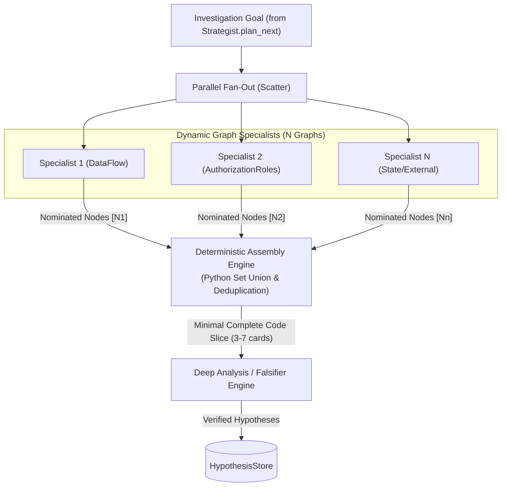

# Proposal: Context-Centric Graph Specialists with Scatter-Gather Assembly

## 1. Executive Summary

This proposal outlines the architectural migration of Hound from a **role-centric sequential pipeline** (`Scout` $\rightarrow$ `Strategist`) to a **context-centric graph specialist architecture** powered by **Scatter-Gather deterministic node assembly**.

Instead of relying on an LLM Orchestrator to guess which single specialist should handle an investigation or managing complex inter-agent chat protocols, work is executed via a deterministic fan-out:

1. **Dynamic Graph Specialists:** $1$ dedicated agent per dynamically discovered graph projection.
2. **Scatter-Gather Code Assembly:** For each investigation goal, all specialists independently nominate relevant nodes from their domain graph. A fast, deterministic Python engine computes the union, deduplicates, and caps the code slice.
3. **Focused Deep Analysis & Verification:** The assembled cross-domain code slice is analyzed by the deep reasoning engine / in-loop falsifier with zero missing context and zero prompt bloat.

---

## 2. Limitations of Hound's Current Architecture

In Hound's current design ([`agent_core.py`](file:///C:/Code/Solidity/tool/hound/analysis/agent_core.py)):

- **Lack of Domain Graph Information:** Scout starts solely with the coarse `SystemArchitecture` graph. It completely lacks domain-specific graph topologies, typed relationships (e.g., `guarded_by`, `mints`, `burns`, `derived_from`), and living annotations (`observations` and `assumptions`) present in aspect graphs like `AuthorizationRoles` or `AssetFlow`. Without domain graph edges visible, Scout cannot discern _which_ dependencies enforce security invariants and which are noise.
- **Availability Bias & Tool Inertia:** Because `SystemArchitecture` is auto-loaded by default, Scout anchors on what is immediately visible and rarely invokes `load_graph` proactively to pull in specialized domain graphs.
- **Context Pollution on Dynamic Load:** In the rare event that Scout does invoke `load_graph`, the new graph topology is stacked directly below `SystemArchitecture` in `self.loaded_data['graphs']`, bloating context with conflicting schemas and diluting model attention.

---

## 3. Why Naive Multi-Agent Partitioning Fails

A common intuition when adopting context-centric designs is to partition agents by physical code boundaries (e.g., assigning Contract A to Agent A and Contract B to Agent B). In smart contract security, this fails because:

- High-severity DeFi vulnerabilities are predominantly **cross-contract composability bugs** (state desynchronization, oracle front-running, token transfer hooks, fee-on-transfer discrepancies).
- Isolating agents by physical subsystem creates fatal blind spots at the interfaces where exploits actually manifest.

---

## 4. Proposed Architecture: Graph Specialists & Deterministic Assembly

### 4.1 Dynamic 1:1 Mapping: 1 Agent per Discovered Knowledge Graph

In Hound, graph topologies are not hardcoded; they are discovered dynamically by the LLM during the initial discovery phase ([`GraphDiscovery.graphs_needed`](file:///C:/Code/Solidity/tool/hound/analysis/graph_builder.py#L139-L154)).

The agent swarm mirrors this dynamic discovery:

- **Dynamic Swarm Sizing:** For every `GraphSpec` produced by `GraphDiscovery` (whether 2, 4, or $N$ graphs tailored to that specific protocol), the system instantiates exactly **one dedicated Graph Specialist**.
- **Domain Specialization via Prompt & Focus:** Each specialist receives only its designated graph, initialized with system prompts and reasoning objectives matching the `focus` field defined in its `GraphSpec` (e.g., token flows, role hierarchies, state transition machines, or custom protocol hooks).

Because each graph is a **full-system projection** of a specific property, no cross-contract interactions are missed within that invariant dimension. Because each agent holds **only its discovered graph**, context pollution and schema mixing are completely eliminated.

### 4.2 Scatter-Gather Deterministic Node Assembly (Replacing the LLM Orchestrator)

Instead of using a brittle, expensive LLM Orchestrator to predict which single specialist should handle an `investigation_goal`, the system uses a **Scatter-Gather** pattern:

1. **Scatter (Broadcast Goal):** An `investigation_goal` is broadcast in parallel to all $N$ specialists.
2. **Domain-Specific Nomination:** Each specialist evaluates the goal against its compact graph topology and nominates 1–$3$ critical node IDs from its domain perspective (e.g., Auth Specialist nominates modifier checks; Economic Specialist nominates token math/balance updates).
3. **Deterministic Assembly Engine (Python Code):**
   - Computes the set union of nominated nodes: `Union = set(N_1) | set(N_2) | ... | set(N_n)`.
   - Ranks and deduplicates nodes (prioritizing nodes nominated across multiple graphs).
   - Enforces a strict budget cap (e.g., top $3$–$7$ code cards) and loads the raw source code cards deterministically.
4. **Zero Routing Hallucinations:** Prevents the failure mode where an LLM router misclassifies an exploit and sends it to the wrong specialist.
5. **No Inter-Agent Communication Overhead:** Specialists do not need to message or wait for each other. They operate independently, and Python handles all aggregation instantly.

---

## 5. Architectural Comparison

| Dimension | Current Hound (Scout $\to$ Strategist) | Naive Module Silos (Contract A vs B) | Context-Centric Graph Specialists |
| :-- | :-- | :-- | :-- |
| **Work Decomposition** | Problem-centric (pipeline steps) | Context-centric (Isolated physical code boundaries) | Context-centric (domain invariant projections) |
| **Cross-Contract Bugs** | Captured if Scout loads all edges; often pruned due to token limits | **Missed** (blind at boundaries) | **Fully Captured** (graphs span whole protocol) |
| **Context Pollution** | High (multiple graphs loaded into one context) | Low | **Optimal** (exactly 1 graph per agent) |
| **Inter-Agent Overhead** | Re-sending multi-turn history + graph schemas into `deep_think` | Continuous multi-turn peer syncing | **$N$ lightweight parallel nomination calls** (zero conversational residue) |
| **Pruning Decisions** | Heuristic guessing (`[S]`/`[M]` nodes) | Rigid file boundaries | Domain-driven edge traversal |

---

## 6. References

- https://claude.com/resources/articles/building-multi-agent-systems-when-and-how-to-use-them
