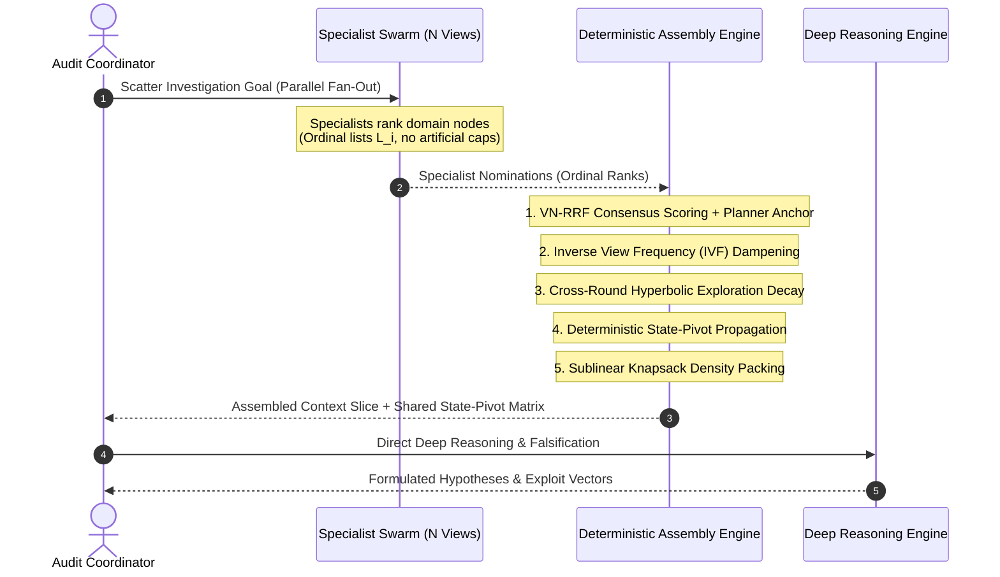
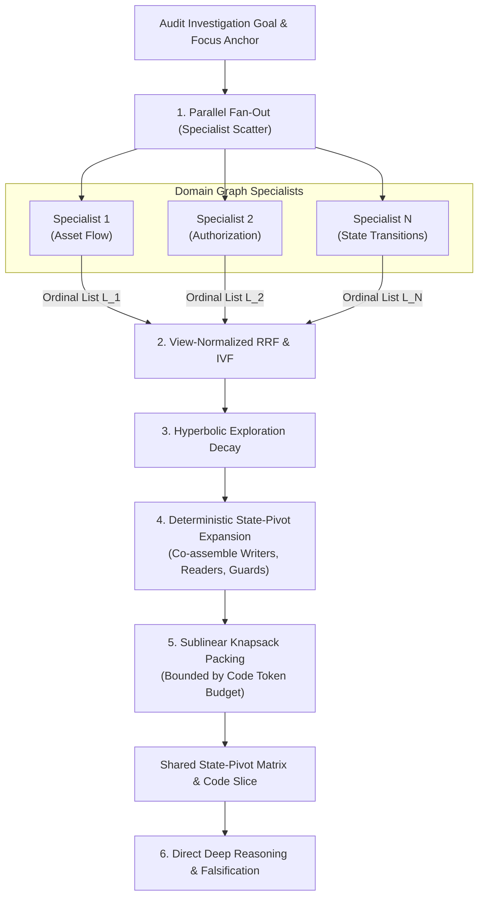

# Proposal: View-Normalized Reciprocal Rank Fusion (VN-RRF), Token-Budget Assembly & Single-Pass State-Pivot Pipeline

## 1. Executive Summary

This proposal presents an advanced aggregation, state-expansion, and context-assembly architecture for multi-agent smart contract security auditing. Building upon the **Context-Centric Graph Specialist** model, this proposal addresses critical limitations identified in multi-agent consensus scoring, context budgeting, and dependency resolution:

1. **View-Normalized Reciprocal Rank Fusion (VN-RRF):** Replaces uncalibrated verbalized float scores with an ordinal rank aggregation framework augmented with **Inverse View Frequency (IVF)**, mathematically neutralizing the "Multi-Graph Hub Trap" where ubiquitous architectural nodes crowd out domain-critical leaf libraries.
2. **Strict Code Token Budgeting via Sublinear Knapsack Packing:** Replaces arbitrary card counts (e.g., hard 3–7 card limits) and node nomination caps (1–3 nodes) with continuous code-size budgeting, ranking code cards by sublinear utility density ($\beta = 0.5$) to prevent bloated contracts from monopolizing context.
3. **Cross-Round Hyperbolic Exploration Decay:** Penalizes repeatedly audited central components across investigation rounds to systematically force agent exploration toward unexamined peripheral contracts.
4. **Single-Pass Deterministic State-Pivot Pipeline:** Eliminates fragile, multi-turn LLM readiness evaluation loops and arbitrary call-graph hop limits. Instead, a single parallel specialist scatter is immediately followed by deterministic state-pivot propagation—co-assembling all writers, guards, and readers of touched state variables across contracts before direct handoff to the deep reasoning engine.

---

## 2. Problem Analysis & Theoretical Limitations

### 2.1 The Multi-Graph Hub Trap (Asymmetric View-Membership Bias)

In multi-view graph architectures, domain specialists query distinct graph projections $\mathcal{G}_i = (\mathcal{V}_i, \mathcal{E}_i)$ representing orthogonal dimensions (e.g., token transfers, role authorizations, state transitions). 

Classical consensus aggregation algorithms (such as `CombMNZ` or linear score summation) assume **homogeneous candidate visibility**—that every voter can observe every entity. In partitioned code graphs, however, a candidate node's visibility is bounded by its **View Membership Count**:

$$
M(u) = \left| \{ i \in \{1, \dots, N_{\text{views}}\} : u \in \mathcal{V}_i \} \right|
$$

- **Architectural Hubs** (e.g., a protocol's main entry point or router) participate in almost every domain graph ($M(u) \approx N_{\text{views}}$). Consequently, they accumulate massive consensus bonuses simply by being visible.
- **Critical Leaf Libraries** (e.g., dedicated arithmetic libraries, custom bit-shift helpers, peripheral validation routines) exist in only one specialized graph view ($M(u) = 1$). 

Under naive linear or additive scoring, specialized peripheral components are mathematically precluded from reaching consensus thresholds, causing the context assembler to repeatedly drop the exact leaf contracts harboring critical security vulnerabilities (e.g., arithmetic overflows, casting truncations).

### 2.2 Uncalibrated Verbalized Score Drift

Prompting heterogeneous LLMs to output raw floating-point relevance scores (e.g., $[0.0, 1.0]$) leads to severe calibration failure:
- Numerical ratings tightly cluster in high ranges ($0.80$–$0.95$), compressing the variance needed for meaningful discrimination.
- Different model architectures or prompt nuances exhibit arbitrary scale variance, allowing a permissive agent outputting $0.98$ to systematically outvote a rigorous agent outputting $0.70$.

### 2.3 The Pathology of Multi-Turn LLM Gather-Refine Loops

Iterative refinement protocols that employ an LLM "readiness evaluator" between search rounds suffer from compounding failure modes:
1. **Phantom Identifier Hallucination:** The evaluator inspects incomplete code slices and guesses missing function or contract names based on generic language conventions rather than actual repository symbols.
2. **Stateless Re-Request Deadlocks:** Because the evaluator evaluates code text statelessly without memory of past queries or index schemas, unresolvable requests are issued cyclically until artificial timeout caps are exhausted.
3. **Redundant Scatter Latency:** Triggering multi-agent fan-out rounds to locate symbols whose references are already present in AST indices introduces massive latency (orders of magnitude slower than deterministic graph lookups) while consuming redundant reasoning tokens.

### 2.4 Why Call-Graph Depth Fails as a Security Boundary Metric

Pruning or expanding code context based on **call-graph hop distance** introduces severe distortion:
- **Coding Style Artifact:** Monolithic functions contain extensive multi-step logic within 1 hop, whereas modular architectures decompose identical logic across 4–6 hops of internal helpers. Depth-based truncation arbitrarily penalizes clean, decomposed code while favoring monolithic implementations.
- **Shared Storage Surface:** Smart contract exploits (reentrancy, access bypasses, state desynchronization) frequently occur across **shared storage slots** between functions that never directly call one another. Call-graph traversals remain completely blind to these cross-contract storage couplings.

---

## 3. Proposed Architecture: Single-Pass State-Pivot Assembly

The proposed architecture streamlines multi-agent code retrieval into a deterministic, single-pass pipeline:

### 3.1 Workflow Stages

---

## 4. Mathematical Formulation & Algorithmic Principles

### 4.1 View-Normalized Reciprocal Rank Fusion (VN-RRF)

Let $\mathcal{G} = (\mathcal{V}, \mathcal{E})$ represent the global code property graph, partitioned into $N_{\text{views}}$ domain projections $\{\mathcal{G}_1, \dots, \mathcal{G}_{N_{\text{views}}}\}$.

For an investigation goal $Q$ and high-level planner focus set $F \subseteq \mathcal{V}$:
- Each specialist $i \in \{1, \dots, N_{\text{views}}\}$ inspects its local graph $\mathcal{G}_i$ and outputs an ordered nomination list $L_i = \langle u_1, u_2, \dots, u_{m_i} \rangle$.
- Let $r_i(u) \in \{1, 2, \dots, m_i\}$ denote the 1-based ordinal rank of node $u$ in $L_i$.
- Let $\text{Noms}(u) = \{ i : u \in L_i \}$ denote the set of specialists that nominated $u$.
- Let $M(u) = |\{ i : u \in \mathcal{V}_i \}| \ge 1$ denote the view membership count of $u$.

The **VN-RRF Score** is formulated as:

$$
\text{Score}_{\text{VN-RRF}}(u) = \underbrace{\left( \sum_{i \in \text{Noms}(u)} \frac{1}{k + r_i(u)} + \frac{\mathbb{I}(u \in F)}{k + 1} \right)}_{\text{Planner-Augmented RRF}} \times \underbrace{\ln\left(1 + \frac{N_{\text{views}}}{M(u)}\right)}_{\text{Inverse View Frequency (IVF)}}
$$

#### Key Mathematical Properties:
1. **Ordinal Scale Invariance:** Relying strictly on integer positions $r_i(u)$ eliminates verbalized score drifting across diverse LLMs.
2. **Harmonic Rank Discounting:** The smoothing parameter $k$ ($k \in [1, 2]$ for concise nomination lists) guarantees that top recommendations dominate while still permitting lower-ranked supporting functions to contribute.
3. **Planner Anchor Voting:** The indicator $\mathbb{I}(u \in F)$ acts as a top-rank vote ($r = 1$), anchoring exploration around strategic target components.
4. **Inverse View Frequency (IVF):** Adapting information-theoretic entity specificity ($\ln(1 + N_{\text{views}} / M(u))$) suppresses omnipresent hub nodes ($M(u) = N_{\text{views}}$) while amplifying isolated leaf nodes ($M(u) = 1$).

### 4.2 Cross-Round Hyperbolic Exploration Decay

To prevent multi-agent audits from repeatedly re-investigating central routing contracts across subsequent investigation phases, node scores are discounted via count-based hyperbolic decay:

$$
\text{Score}_{\text{decayed}}(u) = \frac{\text{Score}_{\text{VN-RRF}}(u)}{1 + \lambda \cdot N_{\text{visit}}(u)}
$$

Where:
- $N_{\text{visit}}(u) \in \mathbb{Z}_{\ge 0}$ records the number of times node $u$ has been assembled into the active context in prior investigation rounds.
- $\lambda \in [0.2, 0.5]$ governs the exploration incentive. As central hubs accumulate visits, their effective scores diminish, systematically shifting the knapsack selection toward unexamined peripheral code.

### 4.3 Deterministic State-Pivot Propagation

Rather than executing secondary LLM scatter rounds to locate dependencies, the assembly engine leverages storage-layout metadata deterministically:

1. **Seed State Extraction:** For every primary node $u$ nominated by specialists, extract all state variables $\mathcal{S}(u)$ read or modified by $u$.
2. **Cross-Contract Sibling Retrieval:** For each state variable $s \in \mathcal{S}(u)$, query the code graph index to retrieve:
   - **Writers:** All external or internal functions that mutate $s$.
   - **Guards:** All modifiers or conditional routines protecting mutations of $s$.
   - **Active Readers:** Functions that compute business logic or access control predicated on $s$.
3. **Degree-Bounded Propagation:** Sibling functions are scored as secondary dependencies and assembled into the candidate pool. To prevent unconstrained expansion across high-degree state variables (e.g., global reentrancy flags), expansion is capped at a maximum degree threshold $D_{\text{max}}$, prioritizing state-mutating writers.
4. **Shared State-Pivot Matrix:** The engine emits a structured cross-contract state interaction matrix alongside the code slice, making variable ownership and cross-contract touchpoints immediately visible to the reasoning engine.

### 4.4 Sublinear Cost-Normalized Knapsack Packing

Let $\mathcal{C}$ denote the set of candidate code cards corresponding to nominated and state-propagated nodes. Each card $c \in \mathcal{C}$ has an associated token footprint $\text{Tokens}(c)$ and an intrinsic relevance score:

$$
\text{CardScore}(c) = \max_{u \in \text{Nodes}(c)} \text{Score}_{\text{decayed}}(u)
$$

Selecting the optimal subset $\mathcal{C}^* \subseteq \mathcal{C}$ under a strict code token budget $B_{\text{max}}$ (e.g., 64,000–128,000 tokens) is formulated as a **0-1 Knapsack Problem**. Sorting candidates purely by $\text{CardScore}(c)$ creates an inefficiency where large contracts consume the budget before smaller helper cards can be included.

Cards are prioritized according to **Sublinear Utility Density**:

$$
\text{Density}(c) = \frac{\text{CardScore}(c)}{\left(\max(\text{Tokens}(c), T_{\min})\right)^\beta}, \quad \beta \in [0.25, 0.50]
$$

- $\beta = 0.5$ (square-root scaling) provides optimal balance: it rewards concise, high-utility helper functions without overly penalizing essential core routines.
- $T_{\min}$ prevents division distortion for trivial one-line getters or declarations.
- Candidates are greedily packed in descending order of $\text{Density}(c)$ until the token capacity $B_{\text{max}}$ is saturated.

---

## 5. Comparative Walkthrough: Leaf Contract vs. Central Hub

Consider an investigation targeting a potential arithmetic truncation in a specialized utility library (`MathLib`):
- **Domain Graph Views ($N_{\text{views}}$):** $5$ (`AssetFlow`, `Authorization`, `Lifecycle`, `Architecture`, `StateStorage`)
- **Smoothing Constant ($k$):** $1.0$
- **Planner Focus Set ($F$):** `{"MathLib"}`

### Candidate A: `MathLib` (Critical Peripheral Leaf)
- **View Membership ($M(u)$):** $1$ (appears exclusively in `Architecture`)
- **Specialist Nominations:** Ranked **#1** ($r = 1$) by the Architecture Specialist
- **Planner Focus Match:** $\mathbb{I}(u \in F) = 1$

$$\text{RRF}(\text{MathLib}) = \frac{1}{1 + 1} + \frac{1}{1 + 1} = 0.50 + 0.50 = 1.00$$

$$\text{IVF}(\text{MathLib}) = \ln\left(1 + \frac{5}{1}\right) = \ln(6) \approx 1.7918$$

$$\text{Score}_{\text{VN-RRF}}(\text{MathLib}) = 1.00 \times 1.7918 = \mathbf{1.7918}$$

### Candidate B: `RouterEntry` (Noisy Central Hub)
- **View Membership ($M(u)$):** $5$ (present in all 5 domain views)
- **Specialist Nominations:** Nominated across 3 views with ranks $r_1 = 1$, $r_2 = 2$, and $r_3 = 2$ (uncalibrated verbalized scores of $0.85$ each)
- **Planner Focus Match:** $\mathbb{I}(u \in F) = 0$

$$\text{RRF}(\text{RouterEntry}) = \frac{1}{1 + 1} + \frac{1}{1 + 2} + \frac{1}{1 + 2} = 0.500 + 0.333 + 0.333 = 1.166$$

$$\text{IVF}(\text{RouterEntry}) = \ln\left(1 + \frac{5}{5}\right) = \ln(2) \approx 0.6931$$

$$\text{Score}_{\text{VN-RRF}}(\text{RouterEntry}) = 1.166 \times 0.6931 = \mathbf{0.8086}$$

### Outcome Analysis:
- **Legacy Additive Model:** `RouterEntry` ($0.85 + 0.5 \times 2 = \mathbf{1.85}$) defeated `MathLib` ($0.90 + 0.50 = \mathbf{1.40}$), causing the critical utility library to be discarded from the context slice.
- **VN-RRF Model:** `MathLib` ($\mathbf{1.7918}$) outranks `RouterEntry` ($\mathbf{0.8086}$) by a **+121.6% relative margin**, cleanly eliminating false-positive hub dominance and preserving the vulnerable code within the context slice.

---

## 6. Architectural Comparison

| Dimension | Legacy Multi-Turn Heuristic Pipeline | Naive Graph-Hop Partitioning | Proposed VN-RRF & State-Pivot Pipeline |
| :--- | :--- | :--- | :--- |
| **Relevance Scoring** | Verbalized float self-scores + arbitrary additive consensus | Unweighted edge proximity or shortest path | **View-Normalized Reciprocal Rank Fusion (VN-RRF)** |
| **Hub Node Bias** | High (hubs accumulate multi-graph consensus points) | Extreme (hubs dominate degree centrality) | **Neutralized** via Inverse View Frequency (IVF) |
| **Context Constraint** | Hard cap on card count (e.g. 3–7 cards) | Hard file or subcomponent boundary | **Continuous Code Token Budget** via Sublinear Knapsack |
| **Dependency Expansion** | Iterative multi-turn LLM scatter (10–20 min / turn) | Call-graph hops (distorts modular vs monolithic code) | **Deterministic State-Pivot Propagation** (1 pass) |
| **Multi-Round Dynamics** | Static scores (redundantly audits central entry points) | Static graph masks | **Hyperbolic Exploration Decay** ($1 / (1 + \lambda N_{\text{visit}})$) |
| **Refinement Overhead** | High (stateless LLM re-requests and phantom deadlocks) | None (static truncation) | **Zero** (single scatter, zero secondary LLM queries) |
| **Cross-Contract Vision** | Fragmented across multi-turn prompts | Blind to uncalled storage relationships | **Complete** via Shared State-Pivot Matrix |

---

## 7. Theoretical Lineage & Academic Foundations

1. **Reciprocal Rank Fusion (RRF):**
   - Cormack, G. V., Clarke, C. L. A., & Büttcher, S. (2009). *"Reciprocal Rank Fusion Outperforms Condorcet and Individual Rank Learning Methods."* In **Proceedings of the 32nd International ACM SIGIR Conference (SIGIR '09)**, pp. 758–759.
2. **Inverse Entity Specificity & IVF:**
   - Spärck Jones, K. (1972). *"A statistical interpretation of term specificity and its application in retrieval."* **Journal of Documentation**, 28(1), 11–21.
   - Chu, J., et al. (2023). *"NuTrea: Neural Tree Search for Context-guided Multi-hop KGQA."* In **Advances in Neural Information Processing Systems (NeurIPS 2023)**.
   - Gutiérrez, B. J., et al. (2024). *"HippoRAG: Neurobiologically Inspired Long-Term Memory for Large Language Models."* In **Advances in Neural Information Processing Systems (NeurIPS 2024)**.
3. **Count-Based Exploration & Hyperbolic Decay:**
   - Strehl, A. L., & Littman, M. L. (2008). *"An analysis of model-based Interval Estimation for Markov Decision Processes."* **Journal of Computer and System Sciences**, 74(8), 1309–1331.
   - Bellemare, M., et al. (2016). *"Unifying Count-Based Exploration and Intrinsic Motivation."* In **Advances in Neural Information Processing Systems (NeurIPS 2016)**.
4. **Sublinear Knapsack Density Optimization:**
   - Dantzig, G. B. (1957). *"Discrete-Variable Extremum Problems."* **Operations Research**, 5(2), 266–277.
