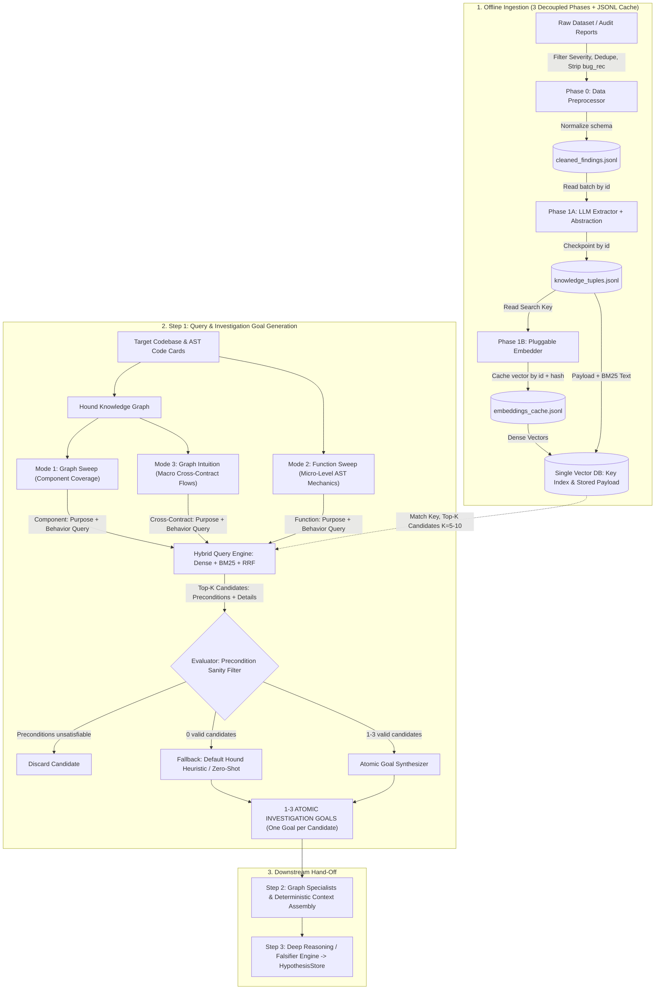

# Proposal: RAG-Driven Investigation Goal Generation for Hound

This proposal specifies the architecture, data schema, decoupled ingestion pipeline, hybrid retrieval strategy, precondition evaluation, and goal synthesis for **Step 1 (Investigation Goal Generation)** in Hound's 3-step security audit workflow:

**Hound 3-Step Audit Workflow:** `Step 1: Investigation Goal Generation (RAG)` ──► `Step 2: Context Assembly (Graph Specialists & Deterministic Assembly)` ──► `Step 3: Deep Analysis & Hypothesis Formulation`

In Hound's multi-agent audit architecture, the resulting investigation goals and focus areas hand off directly to downstream [Context-Centric Graph Specialists](../multi-agent/context_centric_graph_specialists_proposal.md) and [View-Normalized RRF & State-Pivot Assembly](../multi-agent/vn_rrf_gather_refine_proposal.md), while leveraging compiler-grade AST code cards from [Slither AST Parser Integration](../graph/slither_ast_parser_proposal.md).

---

## 1. Executive Summary

This architecture addresses the primary failure mode of relying on a standalone Strategist LLM to synthesize `investigation_goal` targets in Hound: **ungrounded hallucinations and generic, low-signal goals** (e.g., *"check for reentrancy"*, *"verify access control"*).

The proposed RAG system is built on a core principle: **an LLM alone cannot reliably determine which code paths are inherently security-critical out of context, but it excels at producing a neutral mechanism summary of how code behaves.** RAG serves as the knowledge bridge from *neutral runtime mechanics* to *historical trigger preconditions and exploit mechanisms*:

1. **Decoupled 3-Phase Offline Ingestion with ID-Keyed JSONL Caching**:
   - **Phase 0 (Deterministic Data Preprocessing $\rightarrow$ `cleaned_findings.jsonl` — zero LLM cost)**: Clean raw audit corpora (e.g., Code4rena, Sherlock, CVE reports, or aggregated datasets such as `Zaevlad/audit-findings-dataset`) using pure Python: filter to `Critical`/`High`/`Medium` severities, deduplicate and discard empty or placeholder descriptions, strip remediation fields (`bug_rec`), and normalize the input schema prior to LLM extraction.
   - **Phase 1A (LLM Knowledge Extraction $\rightarrow$ `knowledge_tuples.jsonl`)**: Read `cleaned_findings.jsonl`, extract Search Keys (`protocol_type`, `abstract_purpose`, `detailed_behavior`) and Payloads (`trigger_preconditions`, `attack_mechanism`, **strictly omitting `solution_description`**), and checkpoint every record by `id`.
   - **Phase 1B (Embedding & Indexing $\rightarrow$ `embeddings_cache.jsonl` $\rightarrow$ Vector DB)**: Read `knowledge_tuples.jsonl`, compute dense vectors (preferring zero-cost local embeddings or pluggable APIs), and cache vectors by `(id, embed_model, embed_text_hash)` before upserting into the Vector DB—guaranteeing that **records never need to be re-embedded**.
2. **Single Unified Hybrid Vector Store**: Store all indexed knowledge in a single Vector DB (e.g., Qdrant) combining dense semantic vectors with a BM25 sparse lexical index.
3. **Complementary Multi-Mode Retrieval**:
   - **Mode 1 (`Graph Sweep`)**: Traverse architectural components in Hound's Knowledge Graph (`SystemArchitecture`) to summarize contract-level roles and mechanics, guaranteeing 100% architectural coverage (*Systematic Coverage*).
   - **Mode 2 (`Function Sweep`)**: Traverse critical functions via AST-grounded Code Cards to summarize micro-level mechanics (arithmetic, rounding, fee-on-transfer accounting, state ordering).
   - **Mode 3 (`Graph Intuition`)**: Traverse cross-contract topological clusters across Hound's dynamically discovered domain graphs (e.g., `AssetFlow`, `CrossContractInteractions`) to capture macro-level composability risks.
4. **Precondition Evaluator (Sanity Filter) & Zero-Loop Fallback**: Verify whether the target codebase can satisfy a historical bug's `trigger_preconditions` before synthesizing sharp, atomic **Investigation Goals**, falling back directly to Hound's default heuristic/zero-shot goal generation when no candidate matches.

---

## 2. Key Design Agreements

> [!IMPORTANT]
> **Core Architectural Decisions:**
> 1. **Strict Separation Between Search Key and Content Payload**:
>    - **Search Key (Vector & BM25)**: Consists of `protocol_type` + `abstract_purpose` (one-sentence intent summary) + `detailed_behavior` (ordered runtime steps `1. 2. 3...`). Both historical findings (at Ingestion) and target code (at Query time) use this identical representation to guarantee symmetric matching.
>    - **Content / Payload (Returned Context)**: Consists of `trigger_preconditions` (for the Evaluator) + `attack_mechanism` + `vulnerable_snippet_preview` + `full_report_markdown`.
> 2. **Decoupled Phase 0 Preprocessing, Phase 1A LLM Extraction, and Phase 1B ID-Keyed Vector Caching**:
>    - Raw audit datasets often contain duplicates, placeholders, Low/Gas findings, and remediation notes (`bug_rec`). Deterministic Phase 0 preprocessing produces `cleaned_findings.jsonl` at zero LLM cost so tokens are never wasted on noisy records.
>    - Phase 1A writes extracted tuples to `knowledge_tuples.jsonl`, skipping existing `id`s for crash-safe resumption.
>    - Phase 1B caches vectors in `embeddings_cache.jsonl` keyed by `(id, embed_model, embed_text_hash)`. Rebuilding the Vector DB, tuning index parameters, or running repeated experiments reads directly from JSONL without invoking the LLM or embedding backend again.
> 3. **Complete Omission of `solution_description` (Remediation Descriptions)**:
>    - *Empirical basis from Vul-RAG (Table 8)*: **52.4% of False Positives** originate from *Mismatched Fixing Solutions* (the target codebase implements an alternative mitigation pattern, causing the LLM to misdiagnose it as unpatched).
>    - *Role of Step 1*: Step 1 aims to surface **Investigation Goals**, not verify patch equivalence; excluding remediation text prevents reasoning bias and false-positive drift.
> 4. **Mandatory Knowledge Abstraction**:
>    - Historical knowledge must be normalized by replacing concrete variable names, addresses, and internal method identifiers with generalized domain concepts (e.g., `mutex_lock` $\rightarrow$ *"synchronization lock mechanism"*, `_balances[user]` $\rightarrow$ *"user balance"*).
> 5. **Single Hybrid Vector Store & Pluggable Embedding Backends**:
>    - A single Vector DB (e.g., Qdrant, supporting both in-memory execution and persistent local storage) paired with a BM25 sparse index. Dense embeddings support zero-API-cost local execution (e.g., `FastEmbed` on CPU/ONNX or GPU CUDA models) as well as cloud APIs (`text-embedding-3-small`, `voyage-code-02`).
> 6. **No Speculative Risk Guessing by the LLM in Step 1**:
>    - During query formulation, the LLM acts strictly as a neutral code reader (summarizing high-level purpose and sequential runtime steps). Risk association is driven entirely by symmetric retrieval against mechanisms that historically failed.
> 7. **Zero-Loop Fallback Mechanism**:
>    - If the Evaluator eliminates all Top-$K$ candidates, control falls back directly to Hound's default heuristic/zero-shot planner rather than entering iterative re-query loops that inflate cost and induce hallucinations.
> 8. **One Valid Candidate $\rightarrow$ One Atomic Investigation Goal**:
>    - The Evaluator filters only the Top-$K$ ($K = 5\text{–}10$) candidates from Hybrid Search and retains 1–3 precondition-compatible matches. Each surviving candidate is synthesized into its own independent Atomic Goal (never merged) so Step 2 Graph Specialists receive unambiguous, tightly scoped retrieval targets.
> 9. **Clear Separation Between Goal and Hypothesis**:
>    - *Goal (from RAG)*: A historically grounded line of inquiry directing Step 2 code gathering (*"Verify whether function X is susceptible to failure mode Y under precondition Z"*).
>    - *Hypothesis (from Step 3 Deep Reasoning / Strategist)*: A concrete, end-to-end exploit scenario formulated only after inspecting the full cross-contract code slice assembled in Step 2.

---

## 3. System Architecture & Data Flow



---

## 4. Detailed Component Specifications

### 4.1 Knowledge Tuple Schema & Offline Ingestion

#### 4.1.1 `KnowledgeTuple` Data Schema

```python
from typing import List, Optional
from pydantic import BaseModel, Field


class KnowledgeTuple(BaseModel):
    # ==========================================
    # 0. IDENTIFYING METADATA
    # ==========================================
    id: str = Field(description="Unique finding identifier, e.g., C4-2023-05-maia-H-01")
    source_contest: str = Field(description="Audit source or contest platform (e.g., Code4rena, Sherlock, CVE)")
    protocol_type: str = Field(description="Protocol archetype: Lending, AMM, Vault, Staking, Bridge, NFT")
    vulnerability_title: str = Field(description="Concise vulnerability title")

    # ==========================================
    # 1. SEARCH KEY (Dense Embedding & BM25 Sparse Index)
    # Follows Vul-RAG (ACM TOSEM 2026) functional semantics decoupling
    # ==========================================
    abstract_purpose: str = Field(
        description="High-level intent of the code unit (one sentence summarizing what the function/module does)"
    )
    detailed_behavior: List[str] = Field(
        description="Ordered list of runtime execution steps: 1. ..., 2. ..., 3. ..."
    )

    # ==========================================
    # 2. CONTENT / PAYLOAD (Returned to Evaluator & Goal Synthesizer)
    # Follows VulAgent (Findings of ACL 2026) preconditions — OMITS solution_description
    # ==========================================
    trigger_preconditions: List[str] = Field(
        description="Mandatory preconditions required to trigger the bug (e.g., deposited token charges transfer fee, oracle returns 0)"
    )
    attack_mechanism: str = Field(
        description="Concise exploit mechanism explaining how an attacker manipulates data or control flow for gain"
    )
    vulnerable_snippet_preview: Optional[str] = Field(
        default=None, description="Minimal vulnerable code snippet preview (if available)"
    )
    full_report_markdown: str = Field(
        description="Full audit finding text stored in payload as a grounded reference"
    )
```

#### 4.1.2 Extraction Prompts & Knowledge Abstraction Standards

**A. Standardized Functional Semantics Prompts (Used identically across Ingestion and Query):**

1. **Extracting `abstract_purpose`**:
   > `[Code Snippet] What is the purpose of the function in the above code snippet? Please summarize the answer in one sentence with the following format: "Function purpose:".`

2. **Extracting `detailed_behavior`**:
   > `[Code Snippet] Please summarize the functions of the above code snippet in the list format without any other explanation: "The functions of the code snippet are: 1. 2. 3..."`

**B. Knowledge Abstraction Rules (Mandatory during Ingestion):**

- **Abstract Method Invocations**: Replace concrete internal function/helper calls with generalized operational semantics (e.g., `safeTransferFrom` $\rightarrow$ *"perform safe token transfer"*, `_mint` $\rightarrow$ *"mint shares recording ownership"*).
- **Abstract Variable Names & Storage Slots**: Replace project-specific identifiers with logical state roles (e.g., `_balances[user]` $\rightarrow$ *"user balance"*, `totalAssets` $\rightarrow$ *"total managed assets"*).

#### 4.1.3 Three-Phase Ingestion Pipeline & ID-Keyed JSONL Caching

To prevent spending LLM tokens on noisy raw records and eliminate redundant LLM or embedding calls when rebuilding indices or tuning retrieval parameters, offline ingestion is split into **three completely independent phases**:

1. **Phase 0 — Data Preprocessing (`cleaned_findings.jsonl`, zero LLM cost)**:
   - Executed deterministically over raw audit datasets (e.g., Parquet/JSONL corpora such as `Zaevlad/audit-findings-dataset` or contest Markdown repositories from Code4rena/Sherlock).
   - Performs five filtering and normalization operations:
     - **Severity Filtering**: Normalize severity labels (`bug_sev`), retaining only `Critical`, `High`, and `Medium`; discard `Low`, `Gas Optimization`, `Informational`, `Other`, and `Unknown`.
     - **Empty & Placeholder Removal**: Drop rows whose descriptions are too short (`< 50` characters), consist solely of external URLs, or contain placeholder markers (`"See details..."`, `"N/A"`, `"TBD"`).
     - **Deduplication**: Normalize whitespace and lowercase text across `(title, description)` to eliminate duplicate records.
     - **Remediation Removal (`bug_rec`)**: Strip all fix recommendations prior to persistence to enforce the omission of `solution_description` and reduce Phase 1A token consumption.
     - **Schema Normalization**: Emit standardized records `{id, source_contest, severity, title, description, poc}` to `cleaned_findings.jsonl` together with retention/filtering statistics.

2. **Phase 1A — LLM Extraction (`knowledge_tuples.jsonl`)**:
   - Reads directly from `cleaned_findings.jsonl` to ensure clean, uniform inputs across heterogeneous sources.
   - Checks the set of `id`s already present in `knowledge_tuples.jsonl` and **skips already-processed findings** for seamless crash recovery and incremental updates.
   - Invokes the LLM to extract `KnowledgeTuple` (enforcing Knowledge Abstraction and omitting `solution_description`) and appends each record line-by-line to the JSONL store.

3. **Phase 1B — Embedding & Indexing (`embeddings_cache.jsonl` $\rightarrow$ Vector DB)**:
   - Reads `knowledge_tuples.jsonl`, constructs `embed_text` from the Search Key, and computes `embed_text_hash = sha256(embed_text)`.
   - Queries `embeddings_cache.jsonl` by the composite key `(id, embed_model, embed_text_hash)`:
     ```json
     {
       "id": "C4-2023-05-maia-H-01",
       "embed_model": "BAAI/bge-base-en-v1.5",
       "embed_text_hash": "a3f9...",
       "vector": [0.012, -0.045]
     }
     ```
   - On cache hit, **reuses the stored vector directly at zero compute/API cost**; invokes the embedder in batches only for new `id`s or modified Search Keys, appending new cache records to `embeddings_cache.jsonl`.
   - Finally, streams `knowledge_tuples.jsonl` alongside `embeddings_cache.jsonl` to batch-upsert records into the Vector DB and build the BM25 sparse index.

---

### 4.2 Vector Storage & Hybrid Index (Symmetric Matching)

All indexed vulnerability knowledge resides in a **single unified Vector DB** (e.g., Qdrant, supporting both in-memory execution and persistent local disk storage):

- **Pluggable Dense Embedding Backends**:
  - **Local (Recommended for development and bulk ingestion — zero API cost)**: `FastEmbed` (CPU/ONNX models such as `BAAI/bge-small-en-v1.5` or `BAAI/bge-base-en-v1.5`) or GPU CUDA backends (`bge-m3`, `nomic-embed-text` via Ollama/PyTorch).
  - **Cloud API (Optional)**: `text-embedding-3-small` (1536 dimensions) or `voyage-code-02`.
- **Embedded Search Key**:

  $$
  \text{Embed Text (Key)} = \text{protocol\_type} + \text{" | "} + \text{abstract\_purpose} + \text{" | "} + \text{join(detailed\_behavior)}
  $$

  *(Rationale: Ensures complete symmetry—both queries synthesized from a target repository and keys stored in the Vector DB represent neutral intent and sequential execution steps.)*
- **Sparse Index**: BM25 over `abstract_purpose` + `detailed_behavior` + `vulnerability_title` to capture exact technical tokens (`ERC4626`, `WETH`, `mint`, `skim`, `delegatecall`).
- **Hybrid Fusion Ranking**: Reciprocal Rank Fusion (RRF):

  $$
  \text{RRF\_Score}(d) = \frac{1}{60 + \text{Rank}_{\text{dense}}(d)} + \frac{1}{60 + \text{Rank}_{\text{BM25}}(d)}
  $$

- **Stored Payload**: Returns `trigger_preconditions`, `attack_mechanism`, `vulnerable_snippet_preview`, and `full_report_markdown` upon key match. `solution_description` is never stored, preventing mismatched-fix false positives.

---

### 4.3 Multi-Mode Retrieval

In Step 1, the LLM performs only what it does best: **neutral mechanism summarization** of target code, without speculating whether a snippet is vulnerable. Retrieval operates across three complementary modes aligned with Hound's Knowledge Graph and AST Code Cards:

#### Mode 1: `Graph Sweep` (Systematic Architectural Coverage)

- Iterates systematically over major architectural components in Hound's Knowledge Graph (`SystemArchitecture`) to guarantee 100% contract-level coverage.
- Summarizes the component's overall mechanism (core responsibilities, administrative roles, exposed interfaces).
- Issues this summary as a **Query** $\rightarrow$ RAG retrieves historical vulnerabilities tied to that architectural pattern (e.g., Vault upgradeability hazards, `AccessControl` misconfigurations).

#### Mode 2: `Function Sweep` (Maximizing Micro-Level Recall — Vul-RAG Style)

- Iterates over critical functions (state-mutating entry points, value-transfer routines, external calls) via Hound's AST-grounded Code Cards (e.g., compiler-grade Slither AST units carrying `modifiers`, `writes_state_vars`, and `calls`).
- Summarizes each function's runtime mechanism in 1–2 sentences covering:
  - *Data flow*: input parameters and assets/tokens moved.
  - *Interactions & state ordering*: external calls relative to storage mutations.
  - *Arithmetic*: ratio computations, division-before-multiplication, and rounding direction.
- Issues this mechanism summary as a **Query** $\rightarrow$ RAG retrieves historical bugs sharing the **same micro-level mechanism** (e.g., precision loss, fee-on-transfer discrepancies, reentrancy).

#### Mode 3: `Graph Intuition` (Cross-Contract Macro Interaction Coverage)

- Reads cross-contract topological clusters across Hound's dynamically discovered domain graphs (e.g., `AssetFlow`, `CrossContractInteractions`, `AuthorizationRoles`).
- Summarizes multi-contract asset routing and authority delegation mechanics (e.g., a `Spoke` delegating withdrawal settlement to a `Hub`, or a `Vault` accounting yield with a `Strategy`).
- Issues this cluster summary as a **Query** $\rightarrow$ RAG retrieves historical composability bugs exhibiting analogous cross-contract money and control flows.

---

### 4.4 Evaluator (Precondition Sanity Filter)

Rather than scanning the entire corpus, the Evaluator **processes only the Top-$K_1$ candidates** (default $K_1 = 10$) returned by Hybrid Search:

1. **Precondition Validation**: Evaluates each candidate's `trigger_preconditions` against the target codebase to verify whether the prerequisite conditions are structurally reachable.
   - *Example*: A historical bug requires *"deposited token is fee-on-transfer"*. The Evaluator checks whether the target function accepts arbitrary user-supplied ERC20 tokens or restricts deposits to a fixed, trusted whitelist. If unsatisfiable, the candidate is discarded.
2. **Candidate Count Cap ($K_2 = 5$)**: Retains at most $K_2$ valid, highest-compatibility candidates (from which the highest-confidence 1–3 candidates advance to goal synthesis).
3. **Zero-Loop Fallback**: If all Top-$K_1$ candidates fail precondition validation, RAG is bypassed for that target unit and Hound falls back directly to its default heuristic/zero-shot goal generation.

---

### 4.5 Atomic Goal Synthesizer

> [!NOTE]
> **Atomic Goal Principle (1 Candidate $\rightarrow$ 1 Goal):** Each candidate surviving the Evaluator represents a distinct exploit vector and risk assumption. Keeping goals atomic prevents conflating unrelated bug classes and gives Step 2 Graph Specialists precise retrieval targets.

**Inputs:**

- Neutral mechanism summary of the target function, architectural component, or cross-contract cluster.
- Each individual candidate approved by the Evaluator.

**Outputs:** A list of independent **Investigation Goals (`List[InvestigationGoalResult]`)** ready for hand-off to Hound's Step 2 Graph Specialists (where `suggested_focus_areas` and `assigned_specialist_views` seed specialist scatter and VN-RRF/State-Pivot assembly):

```json
[
  {
    "investigation_goal": "Verify whether add() in Hub.sol suffers liquidity balance desynchronization when a Spoke deposits a fee-on-transfer token without measuring the actual received balance delta.",
    "grounded_reference": "Based on precondition pattern from C4-Finding-#142 (Maia DAO)",
    "suggested_focus_areas": ["Hub.add", "Hub._assets", "Spoke.supply"],
    "assigned_specialist_views": ["AssetAndLiquidityFlow", "SystemArchitecture"]
  },
  {
    "investigation_goal": "Verify whether add() allows manipulating initial share pricing via direct token donation to the pool before the first user deposit.",
    "grounded_reference": "Based on share-inflation pattern from Sherlock-Finding-#88 (Vault Inflation)",
    "suggested_focus_areas": ["Hub.add", "Hub.totalSupply", "Hub.shares"],
    "assigned_specialist_views": ["AssetAndLiquidityFlow", "StateModification"]
  }
]
```
