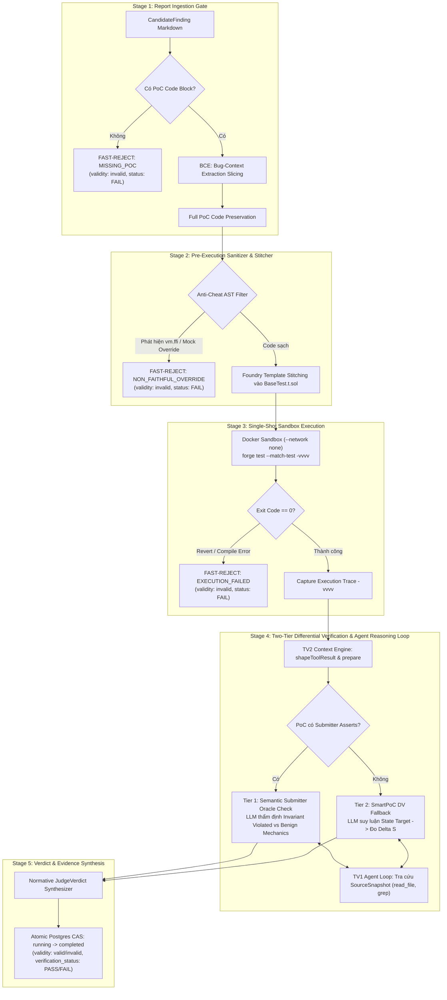
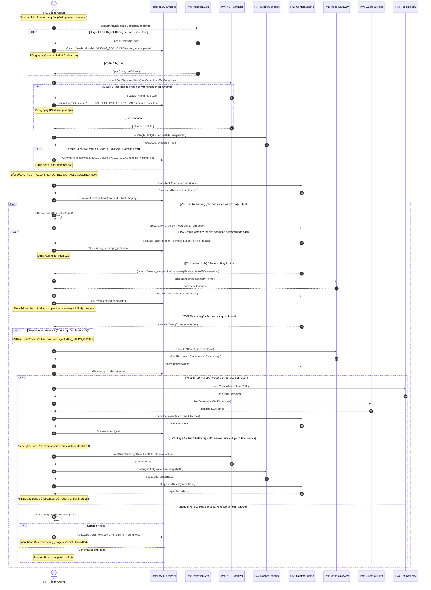

# Thiết kế Agent Loop (Core Orchestrator) — Tích hợp toàn diện SmartPoC Judge Pipeline

> Track: **TV1 — Agent Loop**  
> Trạng thái: **Đề xuất kỹ thuật chính thức**, mang tới buổi chốt Sprint 1.  
> Căn cứ kiến trúc: `blueprint/`, `ADR-008` (TypeScript/Bun Monorepo), tham chiếu `.opencode_reference/`.  
> Tích hợp trực tiếp:
> - **TV4 — SmartPoC Judge Pipeline:** Khớp 100% với đề xuất tại `origin/tv4-judge-pipeline-proposal:proposal.md` (5 stages: Fast-Reject Ingestion Gate, AST Sanitizer, Single-Shot Docker Sandbox, Two-Tier Oracle Adjudication, Verdict Synthesizer).
> - **TV2 — Context Engine:** Khớp 100% với `docs/tv2-context-engine-contract.md` & `docs/tv2-context-research-and-plan.md` (Chu trình `prepare → record → shapeToolResult`, tokenizer `o200k`, quản lý context 6 lớp L0–L5).
> - **TV3 — Tools:** Quản lý dispatch `read_file`, `grep`, `glob` trên `SourceSnapshot` bất biến.

---

## 1. Tầm nhìn Kiến trúc: SmartPoC trong Agent Loop của TV1

Trong bài toán kiểm định bảo mật smart contract, **Judge Mode** là bài toán phân định nghiêm ngặt: nhận một báo cáo lỗ hổng (`CandidateFinding`) từ người dự thi (Code4rena, Sherlock, CodeHawks) và mã nguồn bất biến (`SourceSnapshot`), sau đó đưa ra phán quyết có chứng cứ thực thi (`JudgeVerdict`).

TV1 (Agent Loop) đóng vai trò là **nhà điều phối trung tâm (Core Orchestrator)** xuyên suốt 5 giai đoạn của SmartPoC Judge Pipeline:



### Điểm đột phá của kiến trúc:
1. **Zero-Bias Single-Shot Adjudication:** Ở Judge Mode, gánh nặng chứng minh thuộc về người nộp báo cáo. TV1 áp dụng triệt để nguyên tắc **Zero Repair Loops**: nếu PoC thiếu, gian lận, hoặc chạy revert trong sandbox, pipeline kết luận `invalid` ngay lập tức. Agent loop không bao giờ sửa code exploit hộ submitter.
2. **Tiết kiệm Token tối đa:** Các finding rác hoặc lỗi cú pháp bị loại ngay ở Stage 1–3 mà **không tốn một token LLM nào**. Agent Loop và Context Engine của TV2 chỉ được kích hoạt ở Stage 4 khi PoC đã vượt qua bài test thực thi.

---

## 2. Kế thừa Kiến trúc OpenCode (`.opencode_reference`) vào SmartPoC

Nghiên cứu mã nguồn OpenCode tại `.opencode_reference/packages/core/src/session/` cung cấp 4 thành phần thiết kế nền tảng cho TV1:

| Thành phần OpenCode | File tham chiếu | Ứng dụng trong TV1 SmartPoC |
|---|---|---|
| **Tách biệt Runner & Step** | `session/runner/index.ts`<br>`session/runner/step.ts` | `JudgeRunner` điều phối vòng đời 5 stage của pipeline, quản lý claim job và CAS PostgreSQL. `JudgeStep` thực thi từng turn đơn lẻ trong Stage 4 (preflight context $\to$ 1 model attempt $\to$ parallel tool dispatch $\to$ telemetry). |
| **Retry & Phân loại lỗi hạ tầng** | `session/runner/retry.ts` | Phân loại lỗi hạ tầng (Transport timeout, 429 rate limit, 500/503) với Exponential Backoff + Jitter (`MAX_TIMEOUT_RETRIES = 3`). Đếm riêng từng attempt vào trajectory để TV5 hạch toán chi phí. |
| **Xử lý cạn bước (`max_steps`)** | `session/runner/max-steps.ts` | Khi chạm `max_steps - 1` trong Stage 4, vô hiệu hóa tool (`toolsDisabled: true`) và inject chỉ thị ép model tổng hợp chứng cứ trace để phát ra verdict cuối, tránh run bị timeout vô nghĩa. |
| **Tool Error Normalization** | `tool/runtime.ts` | Mọi ngoại lệ của tool đọc mã nguồn hoặc docker sandbox được bọc thành `ToolExecutionResult` có cấu trúc. Vòng lặp tuyệt đối không văng uncaught exception làm sập worker (cam kết 100 run crash-free). |

---

## 3. Khớp nối 100% với TV2 — Context Engine

Khớp nối hoàn toàn với `docs/tv2-context-engine-contract.md` (hợp đồng nhận/trả) và `docs/tv2-context-research-and-plan.md` (thiết kế 6 lớp).

### 3.1. Năm nguyên tắc hợp tác bất biến giữa TV1 và TV2
1. **Engine không tự gọi model:** Mọi lần gọi model (kể cả lần nhờ model tóm tắt `needs_compaction`) đều do TV1 thực hiện. TV1 quản lý duy nhất các provider attempts và hạch toán chi phí.
2. **Engine không tự nhớ gì (Stateless):** Mỗi lần được gọi, TV1 đưa đủ 4 thành phần cho engine: danh sách mục (`ContextItem[]`), chính sách (`ContextPolicy`), thông tin model (`ModelLimits`), và ngân sách (`RunBudget`).
3. **Engine không sửa lịch sử gốc trong PostgreSQL:** Lịch sử đầy đủ nằm nguyên vẹn trong DB. TV2 chỉ quyết định "bản gửi đi lần này" (`preparedItems`), kèm danh sách thao tác dọn dẹp (`transformations`) để TV1 lưu event.
4. **Tất định tuyệt đối (Deterministic):** Cùng dữ liệu đầu vào $\to$ luôn ra cùng một bản context, bảo đảm tính tái lập của nghiên cứu.
5. **Đơn vị đếm thống nhất bằng `o200k_base`:** Mọi quyết định dọn dẹp hay dừng run đều dùng tokenizer `o200k_base` làm thước đo chung offline.

### 3.2. Phản hồi dứt điểm 3 câu hỏi của TV2 (Mục 9 trong contract)
* **Câu 4 (Thẩm quyền dừng):** **TV1 là Execution Authority**, TV2 là **Signal Authority**.
  * Trước mỗi lần model suy luận ở Stage 4, TV1 gọi `tv2.prepare()`. Nếu TV2 trả về `status: "stop"` (lý do: `context_budget` hoặc `total_tokens`), TV1 lập tức ngắt vòng lặp, CAS run sang `budget_exhausted` và dừng mọi hành động.
* **Câu 5 (Metadata từng mục):** TV1 quản lý lịch sử dưới dạng mảng các mục rời rạc **`ContextItem[]`**, không bao giờ ghép thành văn bản gộp. Mỗi item giữ đầy đủ: `id`, `turn`, `type`, `isPinned`, và `toolMeta` (file, dòng, callId).
* **Câu 6 (Ghi nhận event dọn dẹp):** Danh sách các thao tác dọn dẹp (`transformations`) trả về từ `tv2.prepare()` được TV1 chuyển thành các event `context.transformed` ghi vào bảng `trajectory_event`, lưu kèm mã băm `content_digest` để phục vụ tái lập.

### 3.3. Tích hợp Pipeline 6 lớp của TV2 vào Agent Loop (Stage 4)

```
L0 Đo (o200k) ──► L1 Ngân sách (W_exp - reserve) ──► L2 Định hình output tool
                          │
                          ▼
L3 Giảm tải tất định ──► L4 Nén LLM (compaction) ──► L5 Ghi nhớ (session note)
                          │
                          ▼
                  L6 Telemetry (Ghi nhận vết cho TV5 & TV6)
```

1. **L0 Đo (Measurement):**
   * Ước lượng trước mỗi lần gọi bằng `o200k_base`.
   * Sau mỗi lần model trả lời, TV1 gọi `tv2.record(actualUsage)` truyền số token thật do provider báo để TV2 hiệu chỉnh hệ số an toàn (`safety_margin_factor`).
   * **Token logic của Run:** Được tính bằng tổng toàn bộ `input + output` của mọi lần gọi model, tính cả các lần gọi model để tóm tắt context.
2. **L1 Ngân sách (Active Budget Checking):**
   * Kiểm tra chủ động: $\text{input\_est} \times \text{margin} \le W_{\text{exp}} - \text{reserve}$.
   * Sử dụng một cửa sổ thí nghiệm chung $W_{\text{exp}}$ cho mọi provider để bảo đảm tính công bằng khoa học cho RQ3 (không để model 1M token có lợi thế không phải dọn dẹp so với model 128k).
   * Chừa sẵn một lượng `reserve` (output reserve) để model không bị đứt câu trả lời khi sinh verdict JSON (`finish_reason: length`).
3. **L2 Định hình output tool (`tool_output_shaping`):**
   * Áp dụng ngay khi tool chạy xong: cắt gọt kết quả quá dài theo cả số dòng (`tool_output_max_lines`) và số token (`tool_output_max_tokens`).
   * **Áp dụng trực tiếp cho Execution Trace `-vvvv` của TV4:** Trace Docker sandbox thường dài hàng chục nghìn dòng, TV1 chuyển trace qua `tv2.shapeToolResult()`, giữ lại các stack frame quan trọng và đính kèm marker gợi ý.
4. **L3 Giảm tải tất định (Deterministic Offloading — Trọng tâm giảm chi phí):**
   * Áp dụng 3 cơ chế rẻ theo thứ tự trước khi gọi LLM:
     * *(a) Supersede Reads:* Khi agent đọc lại cùng một file ở dòng mới hơn, bản đọc cũ được thay bằng `[đã có bản mới hơn]`.
     * *(b) Drop Empty:* Bỏ các kết quả tìm kiếm rỗng (`grep` / `glob` không ra kết quả).
     * *(c) Observation Masking:* Ẩn các kết quả tool cũ ngoài cửa sổ gần nhất, thay bằng placeholder:
       `[đã ẩn: read_file Vault.sol dòng 1–400 — đọc lại nếu cần]`
       Vì `SourceSnapshot` bất biến, agent luôn đọc lại được file nếu cần mà không mất mát thông tin.
5. **L4 Nén LLM (`llm_compaction`):**
   * Chỉ kích hoạt khi L3 không đủ đưa context xuống dưới ngưỡng `compaction_threshold` (80%).
   * Chi tiết thuật toán xử lý `needs_compaction` xem tại Mục 3.5.
6. **L5 Ghi nhớ (Session Note):**
   * Hỗ trợ sổ ghi chú tạm thời trong run (giới hạn 2–4k token). Mục này không bao giờ bị ẩn hay tóm tắt để model giữ định hướng điều tra.
7. **L6 Telemetry:**
   * Sau mỗi lần `prepare()`, TV1 lấy telemetry report từ TV2 (phân bổ token theo từng loại mục, token tiết kiệm được, digest) để lưu vào bảng `trajectory_event`.

### 3.4. Thứ tự 7 tầng Context tối ưu cho Prompt Cache
Để tận dụng tối đa cơ chế **Prompt Caching** của Claude/OpenAI/Gemini và tránh hiện tượng *Lost-in-the-middle*, TV1 duy trì trật tự cố định trong context:
1. **System Prompt & Tool Definitions & Verdict Schema** (Tiền tố bất biến 100% qua mọi step).
2. **CandidateFinding Markdown & Submitter PoC** (Pinned — Không bao giờ bị ẩn/nén).
3. **BCE Sliced AST Context** (Pinned).
4. **Bản tóm tắt Compaction** (Nếu đã từng nén ở L4).
5. **Lịch sử hội thoại nối thêm** (Phần cũ bị ẩn ở L3 vẫn giữ nguyên placeholder vị trí).
6. **Session Note bản mới nhất** (Nếu có).
7. **Kết quả Tool mới nhất / Execution Trace `-vvvv` đã cắt gọt**.

### 3.5. Thuật toán Xử lý `needs_compaction` trong Agent Loop
Khi `tv2.prepare()` trả về `status: "needs_compaction"`, TV1 thực hiện chu trình xử lý nén như sau:

```mermaid
flowchart TD
    A[tv2.prepare trả về: needs_compaction] --> B[Lấy summaryPrompt & itemsToSummarize]
    B --> C{compactionCount < maxCompactions?}
    C -- Hết lượt nén --> D{Context có vừa W_exp?}
    D -- Vừa --> E[Cho phép gửi tiếp]
    D -- Vượt --> F[CAS running -> budget_exhausted (context_budget)]
    C -- Còn lượt --> G[Đóng gói summaryPrompt thành ModelAttempt độc lập]
    G --> H[Gọi Model Gateway: executeAttempt]
    H --> I[tv2.record(summaryUsage): Cộng dồn token & chi phí]
    I --> J[Tạo ContextItem mới: type = compaction_summary]
    J --> K[Thay thế các item cũ bằng compaction_summary]
    K --> L[Ghi event context.compacted vào Postgres]
    L --> M[compactionCount++]
    M --> N[Gọi lại tv2.prepare để kiểm tra lại context]
    N --> O[Tiếp tục chu trình bình thường]
```

* **Quy tắc vàng:** Lần gọi model để tóm tắt **vẫn là một provider attempt**, phải hạch toán chi phí đầy đủ, ghi nhận thời gian trễ và cộng dồn vào ngân sách `runBudget`.

### 3.6. Bảng danh mục Cờ cấu hình Ablation Study cho TV5
TV1 nhận các cờ từ `config/flags.yaml` và truyền nguyên vẹn vào `ContextPolicy` của TV2:

| Tên cờ trong `flags.yaml` | Lớp TV2 | Mô tả hành vi khi BẬT (`true`) | Khi TẮT (`false`) |
|---|---|---|---|
| `flags.enable_tool_truncation` | L2 | Cắt gọt output tool & trace `-vvvv` theo token/dòng | Giữ nguyên văn toàn bộ output |
| `flags.enable_obs_masking` | L3 | Ẩn kết quả tool cũ ngoài cửa sổ gần nhất | Giữ nguyên toàn bộ kết quả đọc cũ |
| `flags.enable_supersede_reads` | L3 | Thay bản đọc file cũ bằng bản đọc mới hơn | Giữ lại mọi lần đọc trùng lặp |
| `flags.enable_drop_empty` | L3 | Xóa kết quả tìm kiếm rỗng | Giữ lại các kết quả rỗng |
| `flags.enable_llm_compaction` | L4 | Cho phép gọi model tóm tắt khi context đầy | Cấm tóm tắt, nếu vượt thì dừng run |
| `flags.enable_session_note` | L5 | Kích hoạt sổ ghi chú tạm thời cho agent | Không dùng sổ ghi chú |
---

## 4. Chi tiết 5 Giai đoạn Triển khai (Pipeline Specification)

### 4.1. Stage 1: Report Ingestion Gate
* **File:** `packages/core/src/judge/report-ingestion.ts`
* **Nhiệm vụ:**
  1. Quét tài liệu Markdown của finding để tìm khối mã test (````solidity` hoặc ````foundry`).
  2. **Fast-Reject Ingestion:** Nếu không tìm thấy PoC $\to$ phát ra `JudgeVerdict`:
     ```json
     {
       "validity": "invalid",
       "verification_status": "FAIL",
       "reason": "MISSING_POC",
       "confidence": "HIGH",
       "summary": "Báo cáo bị từ chối ngay lập tức do không cung cấp mã PoC có thể thực thi theo quy định của Judge Mode."
     }
     ```
     Chuyển CAS sang `completed`, ghi nhận `run.completed`.
  3. **BCE Slicing:** Sử dụng Slither / AST Parser phân tích các contract và hàm được viện dẫn trong repo `SourceSnapshot`, trích xuất đồ thị gọi hàm (call graph) để làm ngữ cảnh phụ trợ.
  4. **Preserve PoC:** Giữ nguyên 100% mã PoC gốc (bao gồm helper contracts, interfaces, attacker contract).

### 4.2. Stage 2: Pre-Execution Sanitizer & Template Stitcher
* **File:** `packages/core/src/verification/sanitizer.ts`
* **Nhiệm vụ:**
  1. **Anti-Cheat AST Filter:** Duyệt AST của file PoC. Tìm kiếm các mẫu gian lận:
     * Lệnh gọi `vm.ffi(...)` (nguy cơ thoát sandbox hoặc giả lập dữ liệu ngoài).
     * Override lại các hàm của target contract nhằm đổi logic thay vì khai thác thực tế.
     * Mock các biến state nội bộ bằng bytecode can thiệp trực tiếp (`vm.store` vào các slot không hợp lý).
     Nếu phát hiện gian lận $\to$ Fast-Reject: `reason: "NON_FAITHFUL_OVERRIDE"`, chuyển CAS `completed`.
  2. **Template Stitching:** Tìm template test có sẵn trong snapshot (`test/BaseTest.t.sol` hoặc `test/TestSetup.t.sol`). Trích xuất hàm `test...()` và inject vào template, bảo đảm kế thừa toàn bộ remapping, pragma và contract deployment đã cấu hình sẵn của repo.

### 4.3. Stage 3: Single-Shot Sandbox Execution
* **File:** `packages/core/src/verification/docker-sandbox.ts`
* **Nhiệm vụ:**
  1. Khởi tạo container Docker tạm thời: cấm mạng hoàn toàn (`--network none`), giới hạn tài nguyên (`--cpus 2 --memory 4g`), tự hủy sau khi chạy (`--rm`).
  2. Mount file test đã stitch và thư mục `source/` (Read-only).
  3. Thực thi lệnh: `forge test --match-test <test_name> -vvvv`.
  4. **Single-Shot Evaluation:**
     * Nếu exit code != 0 hoặc test bị revert $\to$ Fast-Reject: `reason: "EXECUTION_FAILED"`, `verification_status: "FAIL"`.
     * Nếu exit code == 0 $\to$ Thu thập toàn bộ raw trace output `-vvvv` và chuyển sang Stage 4.

### 4.4. Stage 4: Two-Tier Differential Verification & Agent Reasoning Loop
* **File:** `packages/core/src/judge/adjudication-step.ts`
* **Nhiệm vụ:** Đây là giai đoạn trí tuệ nhân tạo (LLM reasoning) thẩm định ngữ nghĩa của kết quả thực thi.
  1. **Phân nhánh Oracle:**
     * **Tier 1 (Submitter Assertion Verification):** Nếu mã PoC có sẵn assertion (`assertEq`, `assertGt`, `vm.expectRevert`):
       * Model đọc execution trace và source code, trả lời câu hỏi cốt lõi: *"Các assertion này có thực sự chứng minh hành vi xâm phạm bảo mật trái phép (invariants violated), hay chỉ là hành vi vận hành bình thường của hệ thống (benign mechanics)?"*
     * **Tier 2 (SmartPoC DV Fallback):** Nếu PoC không có assertion (chỉ chạy qua các bước hoặc dùng `console.log`):
       * Model phân tích narrative của finding $\to$ suy luận các biến trạng thái mục tiêu (ví dụ: `balanceOf`, `totalSupply`, `debt`).
       * Model sinh mã state probe: chèn lệnh kiểm tra chênh lệch trạng thái $\Delta S = S_{\text{post}} - S_{\text{pre}}$.
       * Re-run test trong sandbox để kiểm chứng $\Delta S$.
  2. **Vòng lặp Multi-turn với TV3 Tools:** Trong quá trình thẩm định Oracle, nếu model cần đối chiếu lại logic hàm trong contract, nó có thể gọi `read_file`, `grep` thông qua Tool Registry (TV3), có Guardrail của TV4 giám sát.
  3. **TV2 Preflight & Budgeting:** Trước mỗi lần model suy luận, TV2 kiểm tra ngân sách. Nếu trace quá dài, TV2 cắt tỉa bằng `shapeToolResult`.

### 4.5. Stage 5: Verdict & Evidence Synthesis
* **File:** `packages/core/src/judge/verdict-synthesizer.ts`
* **Nhiệm vụ:**
  1. Model phát ra kết luận cuối cùng có cấu trúc theo schema `judge-verdict-v1`.
  2. TV1 validate schema độc lập. Nếu đạt:
     * Exploit hợp lệ: `validity: "valid"`, `verification_status: "PASS"`, `severity: "CRITICAL" | "HIGH" | "MEDIUM"`, đính kèm trích dẫn dòng code từ `SourceSnapshot`.
     * Không hợp lệ: `validity: "invalid"`, `verification_status: "FAIL"`, đính kèm phân tích phản biện.
  3. Thực hiện transaction ghi Verdict, Evidence, và chuyển CAS state `running → completed`.

---

## 5. Đặc tả Kỹ thuật TypeScript (`@harness/protocol` & `@harness/core`)

### 5.1. Hợp đồng Giao diện Context Engine (TV2 Contracts)
Khớp 100% với `docs/tv2-context-engine-contract.md` và `docs/tv2-context-research-and-plan.md`:

```typescript
// packages/protocol/src/context.ts

export type ContextItemType = 
  | 'system_prompt'          // Hướng dẫn hệ thống (prefix bất biến)
  | 'tool_description'       // Mô tả tool (TV3)
  | 'candidate_finding'      // Finding cần chấm (Pinned - không bao giờ ẩn)
  | 'submitter_poc'          // Mã PoC của submitter (Pinned)
  | 'bce_sliced_ast'         // Code slice trích xuất AST (Pinned)
  | 'assistant_reasoning'    // Câu trả lời / suy luận của model
  | 'tool_request'           // Lời gọi tool do model phát ra
  | 'tool_result'            // Kết quả tool trả về
  | 'execution_trace'        // Trace forge test -vvvv từ sandbox (TV4)
  | 'compaction_summary'     // Bản tóm tắt ngữ cảnh cũ (L4)
  | 'session_note';          // Sổ ghi chú tạm thời (L5)

export interface ContextItem {
  id: string;
  turn: number;
  type: ContextItemType;
  isPinned: boolean;
  content: string;
  toolMeta?: {
    callId: string;
    toolName: string;
    filePath?: string;
    lineRange?: [number, number];
    isError?: boolean;
  };
}

export interface ContextPolicy {
  policyVersion: string;
  windowLimitTokens: number;        // W_exp: Cửa sổ chung cho mọi provider
  outputReserveTokens: number;      // Phần chừa cho output của model
  compactionThreshold: number;      // Ngưỡng bắt đầu dọn (mặc định 0.8)
  recentWindowTokens: number;       // Giữ nguyên phần gần nhất (ví dụ 20k token)
  toolOutputMaxTokens: number;      // Giới hạn token cắt output tool
  toolOutputMaxLines: number;       // Giới hạn dòng cắt output tool (ví dụ 400 dòng)
  maxCompactions: number;           // Số lần tóm tắt tối đa trong một run (ví dụ 3)
  flags: {
    enableToolTruncation: boolean;  // L2
    enableObsMasking: boolean;      // L3: Ẩn kết quả tool cũ
    enableSupersedeReads: boolean;  // L3: Bỏ bản đọc trùng
    enableDropEmpty: boolean;       // L3: Bỏ kết quả rỗng
    enableLlmCompaction: boolean;   // L4: Nén bằng LLM
    enableSessionNote: boolean;     // L5: Sổ ghi chú
  };
}

export interface ModelLimits {
  maxContextTokens: number;
  maxOutputTokens: number;
  safetyMarginFactor: number;       // Hệ số an toàn o200k vs tokenizer của model
}

export interface RunBudget {
  totalTokensUsed: number;          // Tổng input + output của mọi lần gọi
  totalTokenLimit: number;          // Ngân sách tối đa của run
  compactionsCount: number;         // Đã nén mấy lần
  costUsd: number;
}

export interface PrepareResult {
  status: 'ready' | 'needs_compaction' | 'stop';
  stopReason?: 'context_budget' | 'total_tokens';
  preparedItems?: ContextItem[];
  summaryPrompt?: string;           // Soạn sẵn khi status == 'needs_compaction'
  itemsToSummarize?: ContextItem[];
  transformations?: Array<{
    action: 'masked' | 'dropped_empty' | 'superseded' | 'truncated';
    targetItemId: string;
    tokensBefore: number;
    tokensAfter: number;
    replacementNote: string;        // e.g., "[đã ẩn: read_file Vault.sol dòng 1–400 — đọc lại nếu cần]"
  }>;
  telemetry: {
    tokenizer: 'o200k_base';
    policyVersion: string;
    estimatedInputTokens: number;
    estimatedSafetyTokens: number;
    windowLimitTokens: number;
    outputReserveTokens: number;
    tokensSaved: number;
    budgetRemainingTokens: number;
    contentDigest: string;          // Mã băm SHA-256 bản gửi đi để kiểm tra tái lập
  };
}

export interface RecordResult {
  totalTokensUsed: number;
  tokenDelta: number;               // Độ lệch giữa o200k và số thật của provider
  suggestedSafetyMargin: number;    // Gợi ý hệ số an toàn mới
}

export interface ShapeToolResultOutcome {
  content: string;
  isTruncated: boolean;
  tokensBefore: number;
  tokensAfter: number;
  continuationNote?: string;        // e.g., "[đã cắt... muốn xem tiếp đọc từ dòng N]"
}

export interface ContextEnginePort {
  prepare(input: {
    items: ContextItem[];
    policy: ContextPolicy;
    modelLimits: ModelLimits;
    budget: RunBudget;
  }): Promise<PrepareResult>;

  record(input: {
    actualUsage: { promptTokens: number; completionTokens: number; totalTokens: number };
    modelLimits: ModelLimits;
    budget: RunBudget;
  }): Promise<RecordResult>;

  shapeToolResult(input: {
    content: string;
    toolName: string;
    policy: ContextPolicy;
  }): Promise<ShapeToolResultOutcome>;
}
```

### 5.2. Mô hình Phán quyết Chuẩn hóa (Normative Judge Verdict)
```typescript
// packages/protocol/src/verdict.ts
import { z } from 'zod';

export const JudgeVerdictSchema = z.object({
  runId: z.string(),
  findingId: z.string(),
  validity: z.enum(['valid', 'invalid']),
  verificationStatus: z.enum(['PASS', 'FAIL', 'UNVERIFIED']),
  reasonCode: z.enum([
    'EXPLOIT_CONFIRMED',
    'MISSING_POC',
    'NON_FAITHFUL_OVERRIDE',
    'EXECUTION_FAILED',
    'BENIGN_MECHANICS',
    'NO_STATE_DELTA',
    'OUT_OF_SCOPE'
  ]),
  severity: z.enum(['CRITICAL', 'HIGH', 'MEDIUM', 'LOW', 'INFO', 'GAS']).optional(),
  confidence: z.enum(['HIGH', 'MEDIUM', 'LOW']),
  summary: z.string().min(20),
  reasoning: z.string().min(50),
  citesEvidence: z.array(z.object({
    filePath: z.string(),
    startLine: z.number().int().positive(),
    endLine: z.number().int().positive(),
    explanation: z.string()
  })).default([]),
  traceDigest: z.string().optional()
});

export type JudgeVerdict = z.infer<typeof JudgeVerdictSchema>;
```

### 5.3. Model Gateway & Provider Port (Cập nhật ADR-002 theo ADR-008)
```typescript
// packages/protocol/src/model-gateway.ts

export interface ModelAttemptRequest {
  runId: string;
  stepIndex: number;
  attemptIndex: number;
  profileId: string;          // e.g. "openai-responses-gpt-4o"
  items: ContextItem[];
  toolsDisabled?: boolean;    // true khi chạm max_steps
  temperature?: number;
  seed?: number;
}

export interface ModelAttemptResponse {
  attemptId: string;
  finishReason: 'stop' | 'tool_calls' | 'length' | 'error';
  content?: string;
  toolCalls?: Array<{
    id: string;
    name: string;
    arguments: Record<string, unknown>;
  }>;
  usage: {
    promptTokens: number;
    completionTokens: number;
    totalTokens: number;
    costUsd: number;
  };
  latencyMs: number;
  error?: {
    isRetryable: boolean;
    category: 'transport' | 'rate_limit' | 'authentication' | 'invalid_request';
    message: string;
  };
}
```

### 5.4. Hợp đồng Kết quả Bước lặp (OpenCode StepOutcome Pattern)
Kế thừa mô hình thẻ (tagged union) từ `SessionStep` của OpenCode (`.opencode_reference/packages/core/src/session/runner/step.ts`), định nghĩa ranh giới kết quả của mỗi turn reasoning:

```typescript
// packages/protocol/src/step-outcome.ts

export type StepOutcome = 
  | { type: 'completed'; verdict: JudgeVerdict }
  | { type: 'needs_compaction'; summaryPrompt: string; itemsToSummarize: ContextItem[] }
  | { type: 'continue_turn'; toolOutcomes: ToolCallOutcome[] }
  | { type: 'budget_exhausted'; reason: StopReason }
  | { type: 'failed'; error: string };
```

### 5.5. Điều kiện Dừng và Thứ tự Ưu tiên (Stop Precedence)
```typescript
// packages/protocol/src/stop-conditions.ts

export type StopReason = 
  | 'wall_clock_timeout'
  | 'total_tokens_exhausted'
  | 'max_steps_exceeded'
  | 'context_budget_exhausted'
  | 'no_progress_detected';

export interface BudgetLimits {
  wallClockTimeoutMs: number;
  totalTokenBudget: number;
  maxSteps: number;
  noProgressMaxRepeats: number; // Mặc định: 3 lần lặp cùng tool call
}
```

Thứ tự ưu tiên đánh giá khi có nhiều giới hạn cùng chạm ngưỡng tại một safe boundary:
$$\text{wall\_clock\_timeout} \succ \text{total\_tokens\_exhausted} \succ \text{max\_steps\_exceeded} \succ \text{context\_budget\_exhausted} \succ \text{no\_progress\_detected}$$

---

### 5.6. Quy trình Thực thi Bước lặp Đơn lẻ (JudgeStep Execution Lifecycle)
*File dự kiến: `packages/core/src/runner/judge-step.ts`*  
Thay vì để vòng lặp tự do, mỗi bước suy luận là một chu trình nguyên tử (atomic attempt) thực thi tuần tự qua 7 chốt kiểm soát:

1. **Context Preflight (Chuẩn bị Ngữ cảnh):** Gọi `contextEngine.prepare()`. Nếu trả về `stop` $\to$ kết thúc với `budget_exhausted`. Nếu trả về `needs_compaction` $\to$ chuyển tiếp yêu cầu nén lên Runner.
2. **Cảnh báo Chạm trần Bước:** Nếu bước hiện tại là bước áp chót (`stepIndex == maxSteps - 1`), vô hiệu hóa quyền gọi tool (`toolsDisabled: true`) và chèn chỉ thị cảnh báo ép model tổng hợp chứng cứ phát ra Verdict.
3. **Thực thi Gọi Model với Retry:** Chuyển danh sách `preparedItems` tới `ModelGateway`. Toàn bộ lỗi kết nối mạng hoặc lỗi dịch vụ nhà cung cấp được bảo vệ bởi bộ lọc retry hạ tầng.
4. **Ghi sổ Token Thật:** Lấy số lượng token tiêu thụ thực tế từ phản hồi nhà cung cấp, gọi `contextEngine.record()` để cộng dồn chi phí và hiệu chỉnh hệ số an toàn.
5. **Phân nhánh Kết luận (Verdict Branch):** Nếu mô hình không gọi công cụ mà trả về văn bản $\to$ parse và validate schema `JudgeVerdict`. Nếu hợp lệ $\to$ trả về `completed`. Nếu sai format $\to$ tạo thông điệp phản hồi lỗi schema để model sửa ở turn sau.
6. **Điều phối Công cụ Song song (Tool Branch):** Nếu mô hình phát ra danh sách công cụ $\to$ kích hoạt điều phối song song tất định để thu về kết quả thô.
7. **Lọc Bảo mật và Định hình Ngữ cảnh:** Kết quả công cụ đi qua bộ lọc thông tin nhạy cảm của TV4, sau đó đi qua hàm `shapeToolResult()` của TV2 để cắt gọt trước khi trả về `continue_turn`.

---

### 5.7. Quy trình Điều phối Toàn vòng đời (JudgeRunner Pipeline Lifecycle)
*File dự kiến: `packages/core/src/runner/judge-runner.ts`*  
Runner chịu trách nhiệm dẫn dắt toàn bộ 5 giai đoạn của SmartPoC và quản lý vòng lặp cấp cao:

1. **Thẩm tra Tiếp nhận (Stage 1 Ingestion):** Quét mã kiểm thử PoC trong báo cáo. Nếu thiếu mã kiểm thử $\to$ kích hoạt Fast-Reject, ghi nhận phán quyết `invalid` với lý do `MISSING_POC` và chuyển trạng thái hoàn tất ngay (tiêu thụ 0 token LLM).
2. **Kiểm tra An toàn và Ghép Mã (Stage 2 Sanitizer):** Phân tích AST của mã PoC để loại bỏ hành vi gian lận (`vm.ffi`, mock can thiệp logic). Nếu phát hiện gian lận $\to$ kết luận `invalid` với lý do `NON_FAITHFUL_OVERRIDE`. Nếu an toàn $\to$ ghép vào khung kiểm thử `BaseTest`.
3. **Thực nghiệm Cô lập (Stage 3 Sandbox):** Thực thi mã trong Docker sandbox không mạng. Nếu xảy ra lỗi biên dịch hoặc lệnh test bị hoàn tác $\to$ kết luận `invalid` với lý do `EXECUTION_FAILED`.
4. **Khởi tạo và Phục hồi Ngữ cảnh (Stage 4 Initialization):** Nạp lại lịch sử từ cơ sở dữ liệu nếu đây là phiên khôi phục sau sự cố; nếu là phiên mới $\to$ định hình trace thực thi qua TV2 và khởi tạo danh sách mục ngữ cảnh ban đầu.
5. **Vòng lặp Suy luận Chính (Reasoning Loop):** Chạy vòng lặp kiểm tra hủy bỏ tại ranh giới an toàn, lần lượt gọi `executeStepAttempt()`:
   * Nhận `completed` $\to$ ghi nhận phán quyết cuối cùng và chuyển trạng thái CAS `completed`.
   * Nhận `budget_exhausted` $\to$ chuyển trạng thái CAS `budget_exhausted`.
   * Nhận `needs_compaction` $\to$ gọi model tóm tắt ngữ cảnh L4, thay thế các mục cũ bằng bản tóm tắt và lặp lại bước chuẩn bị.
   * Nhận `continue_turn` $\to$ nạp kết quả công cụ vào danh sách ngữ cảnh và tăng chỉ số bước.

---

### 5.8. Chính sách Thử lại Lỗi Hạ tầng (Infrastructure Retry Policy)
*File dự kiến: `packages/core/src/runner/retry-policy.ts`*  
Kế thừa cơ chế phân loại lỗi và giãn cách từ `SessionRunnerRetry` của OpenCode:

* **Phân loại Lỗi:**
  * *Lỗi thử lại được:* Lỗi mạng tầng vận chuyển (Timeout, đứt kết nối), lỗi nghẽn dịch vụ HTTP 429 (Rate Limit), và lỗi máy chủ HTTP 500, 503.
  * *Lỗi từ chối vĩnh viễn:* Lỗi xác thực HTTP 401, lỗi sai cú pháp HTTP 400, model không hỗ trợ tính năng $\to$ ném lỗi dừng ngay, không retry lãng phí.
* **Ngưỡng Giới hạn Thử lại:** Giới hạn tối đa 5 lần retry cho lỗi chung, và **tối đa 3 lần retry cho lỗi timeout** (`MAX_TIMEOUT_RETRIES = 3`) để tránh treo tiến trình quá lâu khi nhà cung cấp gặp sự cố lớn.
* **Thuật toán Giãn cách (Backoff with Jitter):** Độ trễ tăng theo hàm mũ cơ số 2 từ 2 giây đến trần tối đa 10 giây, cộng thêm một khoảng nhiễu ngẫu nhiên (jitter từ 0 đến 1000ms) để tránh hiện tượng nghẽn mạng đồng loạt:
  $$\text{Delay}(\text{attempt}) = \min(10000, 2000 \times 2^{\text{attempt}-1}) + \text{random}(0, 1000)\text{ ms}$$

---

### 5.9. Thuật toán Tái dựng Trạng thái sau Sự cố (State Hydration Algorithm)
*File dự kiến: `packages/core/src/runner/history-hydrator.ts`*  
Bảo đảm bất biến kiến trúc: *PostgreSQL là nguồn thẩm quyền duy nhất, worker có thể dừng đột ngột bất kỳ lúc nào mà không làm mất trạng thái của run*.

* **Nguyên lý Tái dựng:** Khi worker mới tiếp quản một lượt chạy đang ở trạng thái `running`, hệ thống không dựa vào bộ nhớ RAM cũ mà truy vấn toàn bộ sự kiện từ bảng `trajectory_event` sắp xếp tăng dần theo trường `sequence`:
  * Gặp sự kiện thêm mục ngữ cảnh (`context.item_added`) $\to$ đẩy mục đó vào mảng lịch sử.
  * Gặp sự kiện biến đổi ngữ cảnh (`context.transformed`) $\to$ tìm mục tiêu tương ứng trong mảng và thay thế nội dung bằng văn bản đại diện đã được ghi vết (ví dụ: dòng ghi chú đã ẩn kết quả đọc cũ).
* **Kết quả:** Tái tạo chính xác 100% ngữ cảnh mà mô hình đã nhìn thấy ở lượt trước đó để tiếp tục chu trình một cách tất định.

---

### 5.10. Điều phối Công cụ Song song Tất định (Deterministic Parallel Dispatch)
*File dự kiến: `packages/core/src/step/parallel-tool-dispatcher.ts`*  
Khi mô hình phát ra nhiều lời gọi công cụ trong cùng một lượt (ví dụ đọc nhiều tệp đồng thời):

* **Thực thi Bất đồng bộ Đồng thời:** Gán chỉ số vị trí ban đầu (`call_index`) cho từng yêu cầu, sau đó kích hoạt thực thi song song qua cơ chế bất đồng bộ (`Promise.allSettled`) để tối ưu hóa thời gian phản hồi.
* **Bảo toàn Thứ tự Tất định:** Khi toàn bộ lời gọi hoàn tất, danh sách kết quả bắt buộc phải được **sắp xếp lại theo đúng thứ tự chỉ số ban đầu** trước khi đưa vào ngữ cảnh và ghi vào cơ sở dữ liệu.
* **Mục đích:** Bảo đảm chuỗi sự kiện và mã băm toàn vẹn `content_digest` hoàn toàn giống nhau giữa các lần chạy lặp lại, phục vụ công tác tái lập nghiên cứu.

---

### 5.11. Ranh giới Hủy bỏ Hợp tác (Cooperative Cancellation)
*File dự kiến: `packages/core/src/runner/cancellation.ts`*  
Khi người vận hành gửi lệnh hủy bỏ từ giao diện điều khiển, Agent Loop không bị ngắt cưỡng bức giữa chừng mà thực hiện kiểm tra cờ hủy tại 3 ranh giới an toàn:

1. **Ranh giới 1:** Ngay trước khi khởi chạy Ingestion Gate và Docker Sandbox.
2. **Ranh giới 2:** Ngay trước khi gọi Context Engine chuẩn bị ngữ cảnh và gửi yêu cầu tới Model Gateway (tránh phát sinh chi phí API không cần thiết).
3. **Ranh giới 3:** Ngay trước khi phân phối danh sách công cụ tới hệ thống tệp.

Nếu phát hiện cờ hủy $\to$ vòng lặp dừng ngay lập tức, thực hiện chuyển đổi trạng thái CAS sang `cancelled`, bảo toàn toàn bộ dữ liệu lịch sử đã sinh ra trước thời điểm hủy.
---
## 6. Sơ đồ Tuần tự Chi tiết (Sequence Diagram)



---

## 7. Cập nhật ADR-002: Chuyển dịch Provider sang TypeScript/Bun

* **Vị trí Adapter:** Nằm trong `packages/llm/src/providers/` theo kiến trúc module của `ADR-008`.
* **Thư viện chuẩn hóa:** Dùng **Vercel AI SDK (`ai`)** cùng các adapter chính thức (`@ai-sdk/openai`, `@ai-sdk/anthropic`, `@ai-sdk/google`).
* **Cấu hình bắt buộc:**
  * `maxRetries: 0` (tắt auto-retry ngầm của SDK, TV1 chủ động retry lỗi hạ tầng qua `retry-policy.ts`).
  * `streaming: false` (gọi non-streaming đơn lẻ để ghi nhận usage chính xác).
  * Không dùng trợ lý lưu trạng thái của bên thứ ba (OpenAI Assistant Thread). Toàn bộ trạng thái do PostgreSQL quản lý.

---

## 8. Kế hoạch Kiểm thử & Định nghĩa Hoàn thành (Definition of Done)

- [x] **Tích hợp trọn vẹn SmartPoC Pipeline:** Khớp đủ 5 stages của TV4, bảo đảm nguyên tắc Zero Repair Loops trong Judge Mode.
- [x] **Khớp nối TV2 Context Engine:** Xử lý trace lớn qua `shapeToolResult`, duy trì cache prefix, kiểm tra ngân sách trước mỗi lần gọi.
- [x] **Bịt 4 lỗ hổng kiến trúc:** Có cơ chế Hydrate phục hồi sau sự cố, chạy tool song song tất định, kiểm tra Cancel, và phân loại lỗi 2 tầng.
- [ ] **Spike Kiểm thử Fast-Reject (Sprint 2):** Kiểm thử tự động chứng minh finding thiếu PoC hoặc chứa `vm.ffi` bị ngắt ngay lập tức với 0 token LLM tiêu thụ.
- [ ] **Spike Khôi phục Sự cố:** Giả lập ngắt tiến trình worker ở Step 2, khởi động worker mới $\to$ chứng minh đọc lại `ContextItem[]` từ DB và chạy tiếp Step 3 bình thường.
