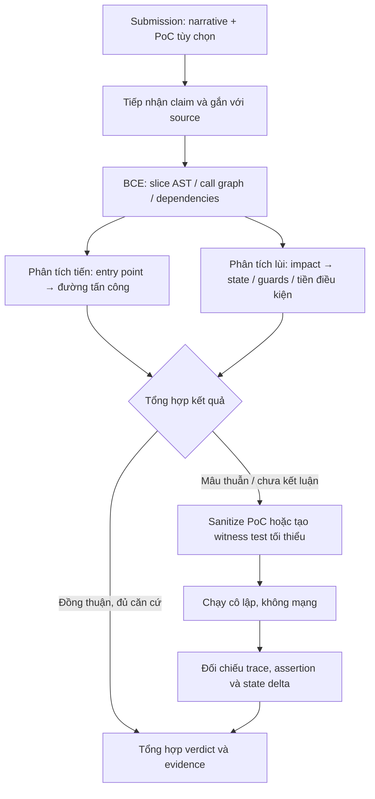

# Đề xuất pipeline Judge Mode hai chiều

> **Nguồn:** Nhánh `tv4-judge-pipeline-proposal`, commit `37571a0` (proposal của thành viên 4).
> **Trạng thái:** Đề xuất nghiên cứu; chưa phải thiết kế được duyệt hay mô tả implementation hiện tại.
> **Mục đích:** Tóm lược và đặt đề xuất vào các ranh giới kiến trúc, an toàn hiện hành của Harness.

## 1. Tóm tắt

Judge Mode nhận một báo cáo lỗ hổng do con người viết, gồm nguyên nhân gốc, đường tấn công, tác động được tuyên bố và có thể có PoC. Đề xuất chuyển SmartPoC từ bộ lọc finding của Audit Mode thành pipeline adjudication: kiểm tra báo cáo theo cả chiều tiến (từ entry point tới code bị khai thác) và chiều lùi (từ trạng thái tác động về các điều kiện cần), sau đó dùng chạy PoC trong sandbox làm bằng chứng thực nghiệm khi hai chiều không thống nhất hoặc chưa đủ kết luận.

Nguyên tắc quan trọng: PoC là bằng chứng để kiểm tra các claim cụ thể, không phải bộ lọc duy nhất; reasoning tĩnh của model cũng không tự nó chứng minh được tính đúng/sai.

## 2. Mục tiêu và ngoài phạm vi

**Mục tiêu**
- Đối chiếu claim của báo cáo với source code, quyền truy cập, điều kiện trạng thái và khả năng thực thi.
- Giảm kết luận dựa trên một hướng suy luận duy nhất.
- Chỉ dùng sandbox cho PoC hợp lệ hoặc những điểm tranh chấp cần kiểm tra bằng thực thi.
- Trả về verdict có căn cứ, trích dẫn source và trạng thái xác minh.

**Ngoài phạm vi**
- Tự phát hiện finding trên toàn repository (Audit Mode).
- Coi kết quả LLM hoặc một lần chạy test là bằng chứng tuyệt đối.
- Cho phép PoC thay đổi implementation, gọi mạng hoặc thoát khỏi snapshot/sandbox.

## 3. Luồng đề xuất

### Stage 1 — Tiếp nhận và bóc tách báo cáo

Chuyển submission thành các claim có cấu trúc: contract/function mục tiêu, nguyên nhân gốc, actor và quyền hạn giả định, từng bước tấn công, impact/state được khẳng định, citation và PoC nếu có. Gắn claim với mã nguồn thực tế; unresolved hoặc citation không khớp phải được giữ là chưa xác minh, không tự suy diễn thành bằng chứng.

### Stage 2 — BCE và xác minh hai chiều

- **Tiến:** từ entry point công khai, lần lượt kiểm tra quyền gọi, tham số, trạng thái đầu vào, nhánh điều khiển, lời gọi nội bộ và điểm revert để xác định đường tấn công có thể đạt tới code đích không.
- **Lùi:** từ impact/sink được tuyên bố, suy ra thao tác và state cần có ngay trước đó; lần ngược các lời gọi/thao tác có thể tạo state ấy tới actor ban đầu; ghi nhận guard hoặc điều kiện bất khả thi.
- **Arbiter:** kết hợp hai kết quả. Hai chiều cùng ủng hộ hoặc có guard cản trở rõ ràng có thể tạo kết luận tĩnh nếu đủ evidence; bất đồng, đường lùi chưa hoàn chỉnh hoặc claim cần xác nhận runtime chuyển sang kiểm tra witness. Không biến “không tìm được đường” thành “đường không tồn tại”.

### Stage 3 — Kiểm tra PoC và tạo witness

Kiểm tra PoC do submitter cung cấp trước khi chạy; loại các khả năng làm sai lệch mục tiêu như thay bytecode/implementation, mock lại đối tượng đang được kiểm tra, `vm.ffi` hoặc hành vi ngoài sandbox. Nếu không có PoC hoặc bất đồng cần phân xử, tạo test tối thiểu chỉ nhắm vào điều kiện đang tranh chấp. Không chấp nhận PoC nếu không thể xác định chính xác claim và assertion mà nó kiểm tra.

### Stage 4 — Thực thi và xác minh bằng chứng

Chạy test trong môi trường ephemeral, không mạng, giới hạn tài nguyên và chỉ mount source snapshot được phép. Kiểm tra exit status, call trace, assertion, đường code thực sự được gọi và chênh lệch state trước/sau so với impact claim. Test pass chỉ hỗ trợ claim mà assertion/trace đã chứng minh; test fail có thể do môi trường hoặc test sai, nên không tự động đồng nghĩa finding invalid.

### Stage 5 — Tổng hợp verdict

Tổng hợp validity, severity (nếu hợp đồng verdict yêu cầu), rationale, citation source chính xác và verification status; phân biệt rõ bằng chứng phân tích tĩnh với bằng chứng thực thi. Thiếu căn cứ hoặc kết quả mâu thuẫn phải được biểu diễn là inconclusive theo contract, không ép thành valid/invalid.

## 4. Quy tắc tổng hợp tối thiểu

| Kết quả phân tích | Hành động đề xuất |
|---|---|
| Tiến đạt được entry/path, lùi tái dựng được điều kiện và impact | Có thể kết luận tĩnh nếu citations và điều kiện đã được kiểm tra đầy đủ; nếu cần xác nhận runtime thì chạy witness. |
| Có guard/điều kiện cản trở rõ ràng được xác nhận từ source | Có thể bác claim tương ứng; lưu guard và citation làm evidence. |
| Hai hướng mâu thuẫn, kết quả chưa hoàn chỉnh, hoặc tác động phụ thuộc runtime | Chạy PoC/witness an toàn; nếu không giải quyết được thì trả inconclusive. |
| PoC không an toàn, không tái lập hoặc assertion không kiểm tra claim | Không chạy hoặc không coi kết quả là evidence; giữ trạng thái chưa xác minh. |

## 5. Tương thích và điều kiện an toàn trong Harness

Đề xuất là hướng nghiên cứu, cần được chuyển đổi trước khi triển khai để khớp với hệ thống hiện tại:

- Giữ đúng **Hexagonal Architecture**: orchestration ở `@harness/core`, chỉ phụ thuộc port; sandbox/provider là adapter. Không đưa đường dẫn/implementation Python cụ thể từ nhánh tham khảo thành cấu trúc bắt buộc.
- Dùng contract hiện hành của `JudgeRunner`, `JudgeVerdict`, sandbox và `SourceSnapshotPort`; không tạo verdict schema song song. Những trường như `PASS/FAIL`, confidence hoặc trạng thái mới chỉ thêm nếu được contract/spec duyệt.
- Không để agent, context, tool, provider request hay trajectory tiếp cận ground-truth labels, adjudication reports hoặc scoring metadata (**Rule R2**). Submission cần kiểm tra ranh giới dữ liệu để không vô tình chứa metadata cấm.
- Chỉ phân tích immutable snapshot; xác thực đường dẫn trước I/O, từ chối absolute path, traversal và symlink escape. Sandbox không mạng, không truy cập host secrets, và chỉ nhận input đã sanitize.
- Mọi hành vi tùy chọn ảnh hưởng output (ví dụ bật phân tích hai chiều, tổng hợp witness, ngưỡng chuyển sandbox) phải là config tường minh và được ghi vào run snapshot/telemetry (**Rule R1**).
- Ghi nhận kết quả theo trajectory append-only, sanitize secrets; giữ riêng reasoning/evidence của model và kết quả quan sát từ sandbox. Không cho phép dữ liệu bên ngoài phá vỡ schema event hay giới hạn kích thước.

## 6. Rủi ro và câu hỏi cần giải quyết trước implementation

1. **Suy luận hai chiều vẫn là suy luận LLM:** đồng thuận không tương đương chứng minh hình thức; cần đánh giá trên corpus và kiểm tra citation/guard bằng source.
2. **Witness tổng hợp có thể sai:** test có thể không tái hiện môi trường, trạng thái khởi tạo hoặc semantics của dự án; cần phân loại lỗi harness/test riêng với kết quả claim.
3. **PoC là mã không tin cậy:** sanitizer theo blacklist không đủ làm ranh giới bảo mật. Cô lập Docker, giới hạn tài nguyên, filesystem và network phải là kiểm soát bắt buộc.
4. **Khái niệm verdict chưa đồng nhất:** proposal nguồn nói đến valid/invalid, PASS/FAIL, severity và confidence; phải ánh xạ chính xác vào `JudgeVerdict` hiện hành, không suy rộng schema.
5. **BCE/call graph có thể thiếu cạnh:** unresolved phải đi theo nhánh inconclusive/witness, không được xem như bằng chứng phủ định.

## 7. Các bước đề xuất để đánh giá

1. Đối chiếu stage và output với `JudgeRunner`, verdict contract cùng sandbox port hiện có.
2. Chốt model claim có cấu trúc, trạng thái inconclusive và evidence tối thiểu cho mỗi kết luận.
3. Thử nghiệm độc lập trên fixture/corpus không lộ ground truth cho agent; scorer giữ tách biệt theo Rule R2.
4. Đo precision/recall, tỷ lệ inconclusive, chi phí và độ lặp lại; chỉ sau đó quyết định bật pipeline/witness trong config.

---

**Phạm vi bản proposal này:** ghi lại ý tưởng của nhánh và chỉ ra các điều kiện tích hợp; chưa chọn provider/model, ngưỡng confidence, giao thức prompt cụ thể hay API/schema mới.
