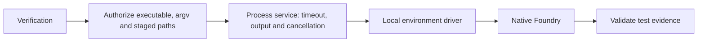

# Design

## Context

The current Docker adapter stages source, verifies compiler artifacts, runs Foundry and interprets output. Its execution contract reaches Judge, adjudication, Audit, CLI and demo fixtures. Production rejects enabled PoC execution and the CLI disabled path has a success-returning placeholder. Old trajectories use stage `sandbox`, cancellation boundary `before_sandbox` and fields `runtime.sandboxMode` / `runtime.foundryImage`.

## Decisions

### 1. Use OpenCode's local execution shape

The reference checkout is `.opencode_reference` at `21eaa626a37f77d7a8d80fa01997fa7d52506c97`. OpenCode's `tool/plugin/shell.ts` checks permissions and revalidates paths before spawn, `shell.ts` manages the process, and `environment/environment.ts` selects a local or provider driver. Harness adopts those boundaries with a single local driver. The reference's `SECURITY.md` describes permissions as application controls. Harness has the same trust boundary for its host driver.

`core/src/execution/` owns `LocalExecutionPort`, authorization, process handling and the driver. `core/src/verification/` owns `VerificationPort`, snapshot projection, the Foundry command and evidence interpretation. Server and CLI compose public core subpaths. Protocol owns safe serialized data. Test doubles live in core testing.

### 2. Limit what Harness starts

Headless policy defaults to deny. Match the executable's verified manifest identity and validate the fixed argument vector, working directory and allowed paths. Check canonical containment and revalidate staged bindings before spawning. Reject traversal, symlink escapes and command overrides. Pass argv directly with shell expansion disabled. The model cannot choose executable, paths, policy, environment or fixture approval.

Build a minimal environment for toolchain needs, with dedicated home and temporary paths. Use explicit stdio bindings and exclude credentials, proxy and compiler-injection settings. Prepare a fresh workspace from `SourceSnapshotPort` and copy only manifest-listed inputs. The canonical source snapshot remains untouched. A staged copy and controlled environment reduce accidental exposure. The OS still gives the child its host account permissions, including access outside staging and to the network.

### 3. Keep the host path outside untrusted and scorer compositions

Native execution is limited to maintainer-reviewed fixture manifests that pin the entire input set, including snapshot, PoC, build inputs, dependencies and toolchain identity. Approval belongs to trusted internal composition, with digest mismatch or an unregistered fixture rejected before spawn. Passing a sanitizer, supplying a model-generated test, or setting `enablePocExecution` alone cannot admit an input. No agent-facing operation can invoke native execution against a user or contest submission.

The internal fixture runner receives only approved fixture data and has no scorer-store dependency or credentials. Run these fixtures in an environment without accessible research labels or scorer secrets. Application rules cannot enforce a filesystem boundary against a malicious executable on a host that exposes those data. Production Judge and normal CLI use an unavailable verifier and never spawn or discover a toolchain through that path. Real state probes stay unavailable. Scripted probes still exercise tier and budget logic offline.

### 4. Use portable admission and honest process guarantees

Admission checks the runtime APIs and pinned toolchain artifacts needed for this host. There is no OS-name allowlist, native sandbox probe or dependency on Seatbelt, bubblewrap, seccomp, cgroups, Docker or an infrastructure VM. Use Bun/TypeScript spawn and path APIs and native executable identities. Handle executable names, path separators, drive roots and case behavior using host rules. Compatibility is established per tested OS/architecture and toolchain, including Windows when those prerequisites are available.

Supervise one invocation with the remaining run deadline, a finite combined output budget and AbortSignal handling. Use the portable runtime controls to stop the owned child on timeout, output exhaustion, cancellation or lease loss. Report uncertain cleanup as infrastructure failure and do not reuse the affected scratch. The portable driver offers no aggregate CPU, memory, PID or scratch quotas and no containment guarantee for detached descendants or supervisor crashes. Reviewed workloads must not start detached background jobs. No hidden retries, dependency downloads or provider calls.

### 5. Prepare trusted Foundry inputs and check the result

Verify offline toolchain manifests by OS/architecture, artifact digest and version. Generate Foundry configuration in trusted code with FFI disabled, known dependencies and explicit build inputs. Invoke only the expected test against the reviewed snapshot. Validate test identity and bind results to snapshot, test and toolchain digests. Missing, malformed, partial or zero-test output cannot produce a verified pass. Distinguish assertion failure, denied, setup/unavailable, timeout, cancellation, output limit and infrastructure failure. Evidence alone does not decide finding validity.

### 6. Version records and measure the replacement

Keep `enablePocExecution` for explicitly enabled internal fixtures. Record it in config, telemetry and immutable snapshots. New `localExecution.version` metadata records disabled status or the enabled host backend, OS/architecture, policy/toolchain/input identities and effective deadline/output bounds. Emit sanitized reasons, byte counts and preparation, process, cleanup and total timings. Exclude host paths and secrets. Changing execution provenance requires a distinct experiment profile.

Write `verification` and `before_verification` for new runs. Decode old stage, cancellation and runtime fields for history only, preserving stored bytes and digests. Use existing run/event snapshots for metadata. Rollback disables host verification while retaining both history formats.

Measure repeated benign fixture invocations with cold/warm definitions, platform, toolchain, sample count, median/p95 and observed resource use. Sampling describes consumption and does not enforce quotas. Use comparable existing Docker baseline data if available. Simulated runs and skipped native tests are not host execution evidence.

### 7. Configure standalone server authentication

Explicit `cli:serve` follows the OpenCode HTTP Basic model. It reads `HARNESS_SERVER_PASSWORD` from its environment or local configuration and uses the fixed username `harness`. The listener remains loopback-only and missing or invalid credentials prevent startup. The server does not persist a generated password. Changing the configured password and restarting rotates access without changing run identities.

### 8. Reuse one local server across CLI commands

Real `judge`, `run`, `view`, `repo add` and `snapshot list` commands discover the same authenticated daemon at `127.0.0.1:4318` or launch it when absent. The exclusive listener is the singleton arbiter when clients start together. Only a process that binds may publish the current PID and randomly generated password to the protected per-user endpoint record. Clients verify PID, authenticated endpoint identity and API version before reuse. The daemon survives client exit and an authenticated stop closes it.

Judge uses the versioned HTTP API and initializes its worker lazily. Other commands use an authenticated streaming command endpoint that accepts only the supported CLI operations and preserves output and exit codes. It cannot invoke server management or arbitrary shell commands. The daemon captures runtime settings from its launch environment. Stop and restart to apply configuration changes. Mock and help paths remain local to the calling process.

## Migration Plan

1. Add execution and verification contracts, versioned metadata and historical fixtures.
2. Implement permission and admission rules, the portable driver and process supervision.
3. Implement and test reviewed-fixture preparation and evidence validation.
4. Migrate core callers, disabled server/CLI composition, traces and deterministic demos.
5. Delete old PoC sandbox code, exports, Docker config and fixtures. Update blueprint, setup docs and attribution where applicable.
6. Validate typecheck, tests, offline demo, stress suite and actual local fixture execution on the available platform matrix.
