# SmartPoC as the Autonomous Core Agent for Judge Mode: Comparative Analysis & Implementation Plan

---

## 1. Summary

In smart contract auditing and automated triage, **Audit Mode** and **Judge Mode** share a unified ultimate objective: **conclusively confirming or rejecting a suspected bug report with grounded proof**.

However, they operate under fundamentally different paradigms:

- **Audit Mode** is a generative discovery pipeline: it scans code, hypothesizes candidate bugs from scratch, and requires an iterative repair loop to synthesize workable exploits.
- **Judge Mode** is an adjudication platform: it evaluates human-authored contest submissions consisting of vulnerability narratives (root cause, attack scenario, impact claims) and optional proof-of-concept (PoC) code.

To avoid the cognitive traps of forward-only LLM reasoning (such as hallucination snowballing, context anxiety, and confirmation bias), Judge Mode integrates **Bidirectional Report Verification** with **Empirical Sandbox Witness Execution**:

1. **Forward Exploration Prompting:** Traces from public entry points forward along the submitted attack path to verify reachability.
2. **Backward Precondition Prompting:** Starts from the claimed impact state (such as drained funds, insolvency, or broken invariants) and deduces backward through required statements, guards, and access modifiers to establish necessary preconditions.
3. **Consensus & Witness Resolution:** When forward and backward reasoning align, the verdict is reached directly with high confidence. When reasoning diverges or claims remain disputed, the engine dispatches the contested condition to the SmartPoC execution sandbox as a targeted witness test.

```mermaid
flowchart TB
 subgraph AuditMode["Audit Mode (Generative Discovery & Synthesis)"]
        A1["Entire Codebase / Repository"]
        A2["LLM Auditor / Static Scanner"]
        A3["BCE AST Slicing"]
        A4["LLM Synthesizes PoC from Scratch"]
        A5["GRE Repair Loop"]
        A6["Synthetic DV State Injection"]
        A7["Precision Filtered Findings"]
  end
 subgraph JudgeMode["Judge Mode (Bidirectional Adjudication Engine)"]
        J1["Contest Submission\nNarrative + Optional PoC"]
        J2["Report Deconstruction Gate\nExtract Root Cause, Impact State, PoC"]
        J3["BCE AST & Call-Graph Slicing"]
        J4["Forward Exploration Prompt\nTrace Call Path & Reachability"]
        J5["Backward Precondition Prompt\nDeduce from Impact State to Guards"]
        J6{"Static Consensus?"}
        J7["High Confidence Static Verdict"]
        J8["SmartPoC Witness Execution\nDocker Sandbox / Foundry Trace"]
        J9["Normative Judge Verdict\nvalid/invalid + PASS/FAIL + Traces"]
  end
    A1 --> A2
    A2 -- Machine JSON Warning --> A3
    A3 --> A4
    A4 --> A5
    A5 --> A6
    A6 --> A7
    J1 --> J2
    J2 --> J3
    J3 --> J4
    J3 --> J5
    J4 --> J6
    J5 --> J6
    J6 -- Full Agreement --> J7
    J6 -- Disputed / Needs PoC Proof --> J8
    J7 --> J9
    J8 --> J9
```

This bidirectional approach grounds report verification in sound program analysis principles while leveraging SmartPoC execution to eliminate subjective human and model bias.

---

## 2. In-Depth Comparative Analysis: Audit Mode vs. Judge Mode

| Dimension | Audit Mode (Verification Layer) | Judge Mode (Autonomous Adjudication Agent) |
| :-- | :-- | :-- |
| **Primary Mission** | **Vulnerability Discovery & Noise Reduction:** Scan code, brainstorm bugs, and eliminate false alarms before human review. | **Adjudication & Verification:** Assess an external contest submission (Code4rena/Sherlock) and determine whether the reported defect and impact are genuine, reachable, and in scope. |
| **Input Artifact** | **Machine-Generated Structured Findings:** High-format JSON (such as implicated functions, contract names, vulnerability categories). | **Human-Authored Contest Submissions:** Semi-structured Markdown detailing vulnerability logic, root causes, attack paths, affected code permalinks, and optional embedded PoC scripts. |
| **PoC Availability** | **None (0%):** Static analyzers and scanner models generate textual descriptions, never runnable Foundry tests. | **Variable:** Submissions may include full Foundry tests, partial snippets, or purely textual/mathematical proofs. PoCs are validated against report claims rather than serving as a blind filter. |
| **Core Technical Hurdle** | **Context Slicing & Cold-Start Generation:** Constructing exploit preconditions from scratch without getting lost in repository scale. | **Context Anxiety & Narrative Grounding:** Overcoming LLM confirmation bias and cascading hallucinations across long descriptions through bidirectional verification. |
| **Role of BCE** _(Bug-Context Extraction)_ | Extracts implicated functions and helper dependencies to fit LLM prompt windows. | Slices target contract AST and call graphs to ground report permalinks and map backward call chains from state mutations back to external entry points. |
| **Execution Loop** | **Iterative Repair Loop (GRE):** Multi-turn repair loop required because generative exploit authoring from scratch has high syntax error rates. | **Targeted Witness Execution:** Single-shot or focused witness execution in an isolated Docker sandbox. Used to validate submitter PoCs or empirically resolve disputed constraints. |
| **Role of DV** _(Differential Verification)_ | Injects synthetic state probes to measure state shifts produced by generated exploits. | **Two-Tier Oracle Adjudication:** Validates submitter assertions against report claims in execution traces, or synthesizes state checks across disputed impact variables. |
| **Output Contract** | Filtered candidate list (`CONFIRMED_VULNERABLE` / `REJECTED_FALSE_POSITIVE`). | Official[`JudgeVerdict`](file:///C:/Code/DATN/harness/blueprint/contracts/judge-verdict.schema.json) with validity, severity, rationale, source evidence citations, and verification status. |

---

## 3. Architectural Blueprint: The SmartPoC Judge Agent

The SmartPoC Judge Agent is structured into 5 cohesive stages:

### Detailed Component Roles

#### 1. Report Deconstruction & Ingestion Gate (`modules/judge/application/report_ingestion.py`)

- **Structured Claim Decomposition:** Parses the submitter's Markdown report into explicit semantic components: target contracts, functions, root cause claims, attack steps, claimed impact state (such as token balance loss or paused state), and embedded PoC code blocks.
- **Repository AST Binding via BCE:** Resolves cited contracts, line ranges, and functions against the target repository's AST using [`BugContextExtractionModule`](file:///C:/Code/DATN/harness/runtime/src/harness/modules/verification/application/bce.py#L7-L12), constructing a focused semantic slice of the code.
- **PoC Ingestion:** If an embedded PoC exists, it is isolated and preserved alongside the narrative claims for downstream validation.

#### 2. Bidirectional Semantic Verification Engine (`modules/judge/application/bidirectional_verifier.py`)

This engine decomposes semantic adjudication into two targeted prompt stages, followed by a consensus arbiter:

##### A. Forward Exploration Prompt (`prompts/forward_verification.md`)

- **Objective:** Evaluate whether an attacker starting at a public entry point can execute through the report's attack scenario to reach the vulnerable code.
- **Input Context Components:**
  1. `report_attack_scenario`: Step-by-step caller actions, parameters, and claimed exploit narrative extracted from the submission.
  2. `bce_source_slice`: Sliced Solidity source code directly output by the BCE module (implicated contracts, functions, dependencies, and storage variables).
  3. `caller_profile`: Caller privilege assumptions (unprivileged external address, token holder, or specific role).
- **Instruction Directives (Reasoning Scaffolding):**
  1. _Entry Access Check:_ Verify if the starting function is callable by the assumed caller profile without role or access restrictions.
  2. _Forward Path Stepping:_ Trace each instruction sequentially. Check parameter constraints, state requirements, and internal function invocations.
  3. _Revert / Obstacle Detection:_ Identify if any branch condition, arithmetic operation, or require statement causes an unavoidable transaction revert.

##### B. Backward Exploit Reconstruction Prompt (`prompts/backward_verification.md`)

- **Objective:** Actively reconstruct and synthesize the bug sequence working backward from the claimed impact. Rather than passively evaluating control flow, the model acts as an inverse engineer: given the target impact, it derives which state transitions, function calls, and caller preconditions must occur in reverse order to produce that outcome.
- **Input Context Components:**
  1. `claimed_impact`: The specific state corruption or invariant failure claimed in the submission (for example: "drain 10 ETH from Vault", "mint unbacked shares", or "permanently freeze withdrawals").
  2. `bce_source_slice`: Sliced Solidity source code directly output by the BCE module (implicated contracts, functions, dependencies, and storage variables).
  3. `caller_profile`: Caller privilege assumptions (unprivileged external address, token holder, or specific role).
- **Instruction Directives (Active Reverse Reconstruction):**
  1. _Sink Identification:_ Identify the exact Solidity statement and enclosing function that can execute the state change representing the claimed impact.
  2. _Inverse State Derivation:_ Determine what contract storage values and caller arguments must exist immediately prior to this statement to prevent a revert.
  3. _Call Sequence Synthesis (Reverse Step-Back):_ Reconstruct which sequence of prior transactions or function invocations (such as prior deposits, flash loan borrows, or manipulated state) can set up those required values.
  4. _Unprivileged Boundary Grounding:_ Trace this reconstructed call sequence backward until it reaches an unprivileged external caller (`msg.sender`).
  5. _Guard Refutation & Feasibility Check:_ If an inescapable modifier (such as `onlyOwner`), an active reentrancy lock, or an invariant check makes the reconstructed sequence impossible, classify the bug as refuted.

##### C. Meet-in-the-Middle Consensus Arbiter

The arbiter cross-references both reasoning outputs:

- **Consensus Valid:** `forward_reachability == REACHABLE` and `backward_status == RECONSTRUCTED`. High confidence valid finding.
- **Consensus Invalid:** Either engine identifies an explicit blocking guard (`forward_reachability == UNREACHABLE` or `backward_status == BLOCKED`). The finding is refuted without wasting sandbox resources.
- **Disputed / Inconclusive:** When results diverge or backward reconstruction is `INCOMPLETE` (the model cannot find a complete backward path, but cannot prove it impossible). The dispute is flagged and dispatched to Stage 3 for empirical witness execution.

#### 3. Pre-Execution Sanitizer & Template Stitcher (`modules/verification/application/sanitizer.py`)

- **Anti-Cheat Validation:** Scans any submitter-provided PoC code to reject unauthorized cheats (such as bytecode overrides of target contracts, mock rewrites, or `vm.ffi` invocations).
- **Template Stitching:** Inserts the test logic into the target repository's native test harness (`test/BaseTest.t.sol`), inheriting pre-configured imports, compiler settings, and environment setup.
- **SmartPoC Witness Synthesis:** When a report lacks a PoC or when bidirectional analysis yields an unresolved dispute, SmartPoC synthesizes a minimal Foundry test script specifically designed to test the disputed constraint.

#### 4. Sandbox Execution & Trace Adjudication (`modules/verification/adapters/docker_sandbox.py` & `modules/verification/application/dv.py`)

- **Isolated Sandbox Execution:** Mounts the stitched test into an ephemeral, non-networked Docker container and executes `forge test --match-test <test_name> -vvvv`.
- **Trace & Assertion Verification:** Inspects the resulting call trace to confirm that the execution exercised the cited functions and satisfied the relevant assertions without unintended reverts.
- **Differential State Verification (DV):** Compares pre- and post-execution state variables against the claimed impact state, confirming that an unauthorized state change actually occurred.

#### 5. Verdict & Evidence Synthesis (`modules/judge/application/verdict_synthesizer.py`)

- Formulates the final normative [`JudgeVerdict`](file:///C:/Code/DATN/harness/blueprint/contracts/judge-verdict.schema.json).
- Populates `validity`, `severity`, source evidence citations with exact line numbers, and detailed rationale combining static bidirectional reasoning with dynamic trace evidence.
